# DCST4 – DICOM C-Store Tester 4

   

A Windows tool for testing a PACS or any DICOM Storage SCP. It generates clearly marked test images that behave like the output of a real modality, and sends them with C-STORE.

For querying a Modality Worklist check out [DMWLT4](https://github.com/droidgren/DMWLT4) .

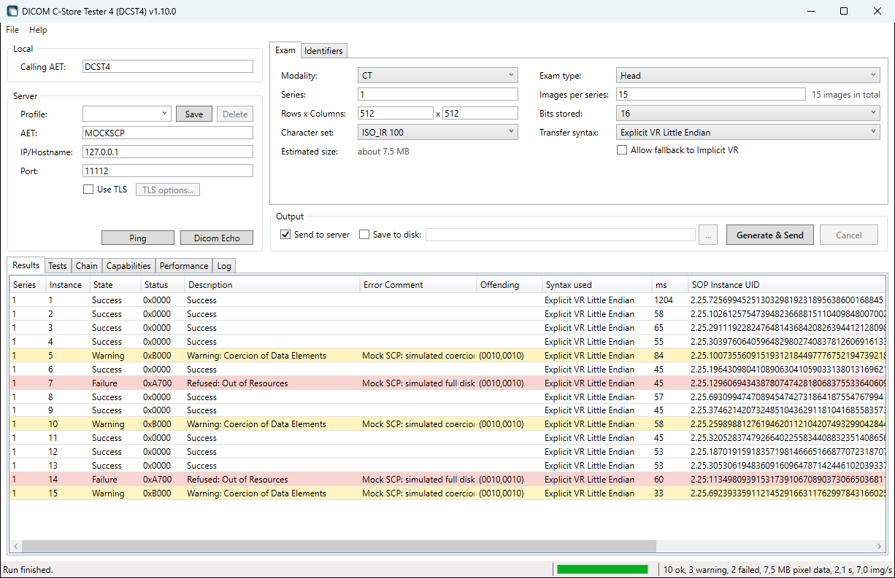


## Table of Contents
* [Features](#features)
* [Install](#install)
* [Usage](#usage)
* [Testing a PACS](#testing-a-pacs)
  * [What the PACS supports](#what-the-pacs-supports)
  * [Store, query and retrieve](#store-query-and-retrieve)
  * [Storage Commitment](#storage-commitment)
  * [Limits and faults](#limits-and-faults)
  * [Performance](#performance)
  * [Reports and comparison](#reports-and-comparison)
* [Test datasets](#test-datasets)
* [Generated tags](#generated-tags)
* [Test personnummer](#test-personnummer)
* [Architecture](#architecture)
* [Reporting Bugs & Feature Requests](#reporting-bugs--feature-requests)
* [Tests](#tests)
* [Dependencies](#dependencies)
* [Files](#files)
* [Changelog](#changelog)
* [License](#license)

## Features

- **Zero Dependencies:** Built on .NET 4.8 (included natively in Windows 10 and 11). No external runtime installation is required.
- **Realistic exams:** CT, MR and PT stacks, CR, DX, US, XA, RF, MG and NM images, and for US, XA, RF, CT, MR and MG also their multi-frame objects: an ultrasound cine loop, a cine run, a fluoro loop, Enhanced CT, MR, XA and XRF and Breast Tomosynthesis, built to their IODs and checked with outside validators, with consistent slice geometry and believable timestamps. See [Checking with another toolkit](#checking-with-another-toolkit) for what is still reported.
- **Everything is automatic, and everything can be overridden:** patient, accession number, study ID, UIDs, date and time. The fields show what the next run will use.
- **Additional tags:** add common tags with generated values, or any custom tag, including private ones, under **File > Settings**.
- **Official test patients:** random Patient IDs come only from Skatteverket's list of test personnummer. Birth date and sex follow from the number.
- **Patient names:** `DCST4^TEST^<number>` by default, which is plainly not a person, or a Swedish name, chosen under **File > Settings**. About 40% of the Swedish names contain å, ä or ö, with Specific Character Set ISO_IR 100 or ISO_IR 192. An empty Specific Character Set (Basic ASCII) is also available, and random names then lose their diacritics.
- **Optional burned-in text:** turn on a text box in the pixels and choose which tags it shows, so you can compare them with the tags in the viewer. It is off by default.
- **Configurable images:** number of series and images, matrix from 64 to 4096, 8 to 16 bits stored as the modality allows, and up to 10,000 frames in a multi-frame image.
- **Private payload:** optionally, a large private binary value in every image, as some ultrasound systems send their raw data, to find out whether a PACS takes it. It is off by default and at every start. See [Multi-frame images and private payload](#multi-frame-images-and-private-payload).
- **Estimated size:** the Exam box shows how much data the whole exam will be, and updates as you change the settings.
- **Transfer syntaxes:** Implicit VR LE, Explicit VR LE, JPEG Lossless (Process 14 SV1) and, for 8 bits stored, JPEG Baseline (Process 1, lossy).
- **Full response logging:** status code, state, description, Error Comment, Offending Element and time for every image, including warnings and vendor-specific codes.
- **Save to disk:** instead of, or in addition to, sending, as a DICOM File-set with a DICOMDIR that viewers can open.
- **Connectivity:** Ping, DICOM Echo, TLS, and saved destination profiles.
- **Reset to defaults:** **File > Settings** puts every setting back to its default in one go, and keeps the saved destination profiles.
- **Test suite:** run tests against a PACS from the **Tests** tab or the command line (`DCST4.Cli.exe`). Each run writes an HTML report, and can also write JSON and CSV files for comparison over time. On the Tests tab the tests are in folded groups, each says in a tooltip what it does, nothing is ticked at the start, and a run that stores objects says how many examinations and how much data it will leave on the destination and asks first. Every setting in the program explains itself on hover, with its default. See [Testing a PACS](#testing-a-pacs).
- **Capability matrix:** finds out from association negotiation alone, with no images sent, which SOP classes and transfer syntaxes a PACS supports, and compares that with what the vendor's Conformance Statement claims. See [What the PACS supports](#what-the-pacs-supports).
- **Store, query and retrieve:** proves the chain accepted, indexed, retrievable and intact for each object type, with C-STORE, C-FIND, C-GET and C-MOVE. What comes back is compared with what was sent, level by level. See [Store, query and retrieve](#store-query-and-retrieve).
- **Storage Commitment:** asks the PACS to commit to what it stored, with N-ACTION, and takes its N-EVENT-REPORT either on the same association or on one the PACS opens to this computer. It records which way the PACS used, how long the report took and the Failure Reason of each instance that was not committed. See [Storage Commitment](#storage-commitment).
- **Limits and faults:** finds how many associations the PACS holds at once, how long it keeps an idle association or a connection that never sends a request, and whether it keeps to the maximum PDU length it announces. Breaks a C-STORE off on purpose in three ways, and checks what the PACS kept and how it takes the retry. With TLS, checks that a client certificate from an unknown authority or an expired one is refused. See [Limits and faults](#limits-and-faults).
- **Performance:** throughput and latency under load, on N parallel associations, from images encoded in advance with new UIDs for every send. A ramp of 1, 2, 4, 8 ... associations finds where the PACS saturates, a soak of hours writes snapshots as it goes and flags degradation, and time-to-available says how soon a stored image can be found. A live chart on the Performance tab, and the plan of how many objects will be stored before anything is sent. The mix `custom` sends the object described on the Exam tab. See [Performance](#performance).
- **Reports:** every run is also written as one HTML file that is complete in itself, with the summary, the capability matrix, the chain, the integrity findings, the limits, Storage Commitment, charts of the Performance tests and the protocol timeline of each failed test. It loads nothing from the network and holds no script. See [Reports and comparison](#reports-and-comparison).
- **Comparison of runs:** two or more saved runs against a baseline: what the PACS no longer supports, tests that now fail, and throughput and latency against a threshold, from the program or with `DCST4.Cli.exe compare`, whose exit code says whether anything regressed. A vendor fingerprint of each system, side by side, for comparing versions and vendors.
- **Protocol timeline:** each test records the steps of the association, from A-ASSOCIATE to A-RELEASE or A-ABORT, with every DIMSE request and response and its raw status.
- **Reproducible test datasets:** the same seed gives the same files, from the command line. Single-frame and multi-frame images, cine XA and RF, Enhanced CT, MR, XA and XRF, SR, Key Object Selection, Presentation State, Encapsulated PDF, Segmentation and RT Structure Set, in compressed variants and with character set and edge-case variants. Each comes with a manifest of hashes. See [Test datasets](#test-datasets).


## Install

You can choose between the installer and the portable version, and neither needs administrator rights.

### Installer

1. Download `DCST4.msi` from the [latest release](../../releases/latest).
2. Double-click the file to install the program.
3. Start **DICOM C-Store Tester** from the Start menu.

The installer installs for the current user only, by default to `%LOCALAPPDATA%\DICOM C-Store Tester`. Uninstalling leaves your settings and logs in `%LOCALAPPDATA%\DCST4`.

### Portable

1. Download the ZIP file from the [latest release](../../releases/latest).
2. Extract the files to a folder of your choice.
3. Run `DCST4.exe`. The command line version `DCST4.Cli.exe` is in the same folder. Keep both next to the `libs` folder.

### Microsoft SmartScreen warning

The program is not digitally signed, so you may see a **Windows protected your PC** warning the first time you run it. To continue, click **More info** and then **Run anyway**.


## Usage

1. Enter the server's AE title, host and port. Try **Ping** and **Dicom Echo**.
2. On the **Exam** tab, select modality and exam type, and how many images you want. 1 series with 1 image gives a single test image. **Estimated size** shows how much data that is. For Implicit and Explicit VR it is calculated. For JPEG Lossless and JPEG Baseline, one sample image is compressed in the background and the result multiplied by the number of images. A saved File-set's DICOMDIR is not counted.
3. Optionally, enter your own values on the **Identifiers** tab by unticking **Auto**.
4. Click **Generate & Send** and follow each image in **Results**.
5. Look the exam up in the PACS viewer. To compare the image with the tags, turn on burned-in text first.

F1 in the program opens the help, with a list of topics on the left.

### When Auto values change

Auto values are drawn when the program starts and when you click **New values**. They stay on screen after a run, so the exam can be looked up in PACS.

Running again without **New values** uses the same patient, accession number and Study UID, so the images arrive as a new series in the same study, also if you changed modality or exam type. Series numbers start at 1 again, and an Auto Study Date/Time is the time of each run. To draw new values after every run instead, tick **Draw new Auto values after each run** under **File > Settings**, on the **Identifiers** tab.

### Burned-in text

By default the images have no burned-in patient details. Under **File > Settings**, on the **Burned-in text** tab, you can turn on a black text box in the upper left corner of each image and tick which tags it shows: Patient's Name, Patient ID, Patient's Birth Date, Patient's Sex, Accession Number, Study ID, Study Date, Study Time, Study Description, Series Description, Body Part Examined, Modality, Series Number, Instance Number, Content Date, Content Time, Institution Name, Station Name and Referring Physician's Name.

The values are read from the image's own tags and shown as they are stored, so a date reads `20261106`. Burned In Annotation is `YES` when text is drawn and `NO` otherwise. The diagonal TEST IMAGE watermark is always there.

### Character sets

The **Character set** list under **Exam** offers ISO_IR 100 (the default), ISO_IR 192 and **Empty value (Basic ASCII / ISO 646)**. Empty value writes Specific Character Set with zero length, which means the default repertoire. Random names and common additional tags then lose their diacritics, so `Åström` becomes `Astrom`, and a manual value with any other character than Basic ASCII stops the run with a message. A strict validator may object to the empty tag, since this Type 1C attribute should have a value when it is present.

### Additional tags

Under **File > Settings**, on the **Additional tags** tab, you can add tags on top of the fixed fields. Each one gets a row on the **Identifiers** tab, where unticking **Auto** lets you type a value for the current session.

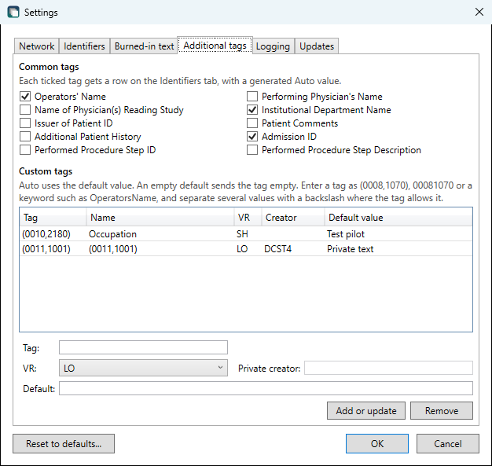

The same tags as rows on the **Identifiers** tab, below the fixed fields. Here Accession No has a typed value and the rest are on Auto:

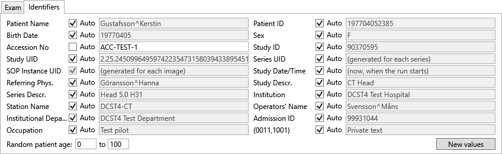

- **Common tags:** tick any of Operators' Name, Performing Physician's Name, Name of Physician(s) Reading Study, Institutional Department Name, Issuer of Patient ID, Patient Comments, Additional Patient History, Admission ID, Performed Procedure Step ID and Performed Procedure Step Description. Auto generates the value.
- **Custom tags:** enter a tag as `(0008,1070)`, `00081070` or a keyword such as `OperatorsName`. The name and VR fill in from the DICOM dictionary. Auto uses the default value you enter, and an empty default sends the tag empty. Separate several values with a backslash where the tag allows it.
- **Private tags:** a tag with an odd group needs a private creator and a VR. The creator is written to the block of the number you entered, so `(0011,2001)` puts the creator in `(0011,0020)`. A receiver using Implicit VR sees these values as UN unless it knows the creator.

A custom tag is written after the program's own tags, so it can replace a generated value such as Manufacturer. Some tags cannot be added, because they would break the image or remove its marking as a test image: groups 0000 to 0007, group lengths, groups 0028 and 7FE0, SOP Class, Modality, Specific Character Set and Image Comments. Tags that already have a field on the **Identifiers** tab are set there. Sequences, binary VRs and AT are not supported, since their values cannot be typed.

### Version check

When the program starts, it asks GitHub for the latest release (`api.github.com`). If there is a new version, a window opens with a link to it and the release notes, which are collapsed until you open them. You only see this window when a new version was found: if GitHub cannot be reached, for example on a closed network, the program says nothing and carries on, and the failure is written to the log.

To turn this off, untick **Show a window at startup when a new version is available** under **File > Settings**, on the **Updates** tab. Nothing is then sent at startup.

Opening **Help > About** also asks GitHub and shows the result in that window, including if the check failed. Nothing is sent except an ordinary web request with the program's version as its User-Agent, and nothing is downloaded or installed.

### Multi-frame images and private payload

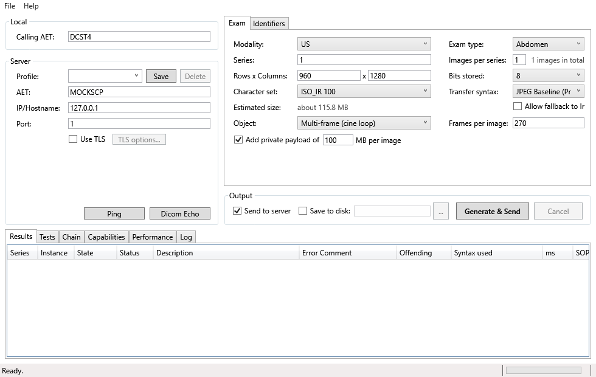

**Modality** is the ten modality codes, and **Object** says which image of that modality to generate:

| Modality | Object |
| -------- | ------ |
| US | Single frame, or **Multi-frame (cine loop)**: Ultrasound Multi-frame Image, an RGB cine loop at 8 bits with Frame Time and Cine Rate for 30 frames per second |
| XA | Single frame, **Multi-frame (cine run)** or **Enhanced XA** |
| RF | Single frame, **Multi-frame (fluoro loop)** or **Enhanced XRF** |
| CT | Single frame, or **Enhanced CT** |
| MR | Single frame, or **Enhanced MR** |
| MG | Single frame, or **Breast Tomosynthesis** |
| CR, DX, PT, NM | Single frame |

Choosing a modality selects Single frame. **Frames per image** says how many frames a multi-frame object has, 1 to 10,000, and is 30 for a cine loop or a cine run, 16 for a fluoro loop and 8 for the enhanced objects when the object is selected. Images per series then starts at 1 and is the number of multi-frame objects. The exam type and the bit depth are kept when the object changes, where the other image allows them. Every frame is drawn and marked like any other test image, with its frame number.

**A cine XA or RF is the same SOP class as the single-frame image.** The Multi-frame and Cine modules of those two IODs are conditional on the number of frames, so a cath lab's cine run and a single spot image are both X-Ray Angiographic Image Storage. The multi-frame object adds Number of Frames, Frame Time, Frame Increment Pointer, Cine Rate and Recommended Display Frame Rate (15 per second for XA, 8 for RF), Preferred Playback Sequencing, and for XA the Positioner Motion that the XA Positioner module then requires. A PACS that takes the single image can still refuse the run, which is what the pair is there to find out.

**Enhanced XA and Enhanced XRF** are SOP classes of their own (1.2.840.10008.5.1.4.1.1.12.1.1 and …12.2.1), the multi-frame functional group objects that newer angiography and fluoroscopy systems send. DCST4 generates them with Image Type `DERIVED`, one plane, no C-arm geometry, no X-Ray Receptor Type and a linear pixel intensity relationship, which is the combination that leaves every conditional module and macro of those IODs out. What is written is the XA/XRF Series and Enhanced XA/XRF Image modules, an Acquisition Context Sequence, and the five mandatory functional group macros: Frame Content per frame, and Frame Anatomy, Frame VOI LUT, Irradiation Event Identification and X-Ray Frame Pixel Data Properties shared by all frames. The Irradiation Event UID follows from the UID root of the profile. These two have no Frame of Reference, no slice geometry and no Dimension Organization, which the Enhanced CT, Enhanced MR and Breast Tomosynthesis objects do have.

The frames are drawn as they are written and are never all in memory, so an object can be much larger than the computer's memory. With JPEG Lossless or JPEG Baseline the frames are encoded before the object is sent, a few at a time on the processor's cores, and the status bar counts them. Cancel works while this goes on. JPEG Baseline is the slow one: a cine loop of 1,667 frames of 960 x 1280 took about three minutes on a computer with 12 cores, and DCST4 used about 500 MB of memory meanwhile. The pixels of an uncompressed image must be less than 4 GB, which is what the length of a DICOM element can hold, so a long cine loop needs a compressed transfer syntax: 1,667 frames of 960 x 1280 in colour are 5.7 GB, and the run then stops with a message that says so.

**JPEG Baseline** is lossy and holds 8 bits, so it can be chosen for both US images, and for CR, DX, XA, RF and NM at 8 bits stored. The image is then marked with Lossy Image Compression `01`, the ratio and the method, and Image Type `DERIVED`. A colour image is stored as `YBR_FULL_422`, as ultrasound systems store theirs. The test images compress better than real ones: a frame of 960 x 1280 is about 58 KB here, and about 90 KB from an ultrasound system.

Enhanced CT, Enhanced MR and Breast Tomosynthesis still lack some attributes that a strict validator names, see [Checking with another toolkit](#checking-with-another-toolkit). The cine loop, the cine run and the fluoro loop pass `dciodvfy` without errors, and the two enhanced X-ray objects pass with remarks that come from the validator's own tables.

**Add private payload of ... MB per image** adds one large private value to every image, the way some ultrasound systems send their raw data along with a cine loop, where it can be four times the size of the pixels. Use it to find out whether a PACS takes images with large private data, and whether it keeps it. It is unticked every time DCST4 starts. The size, 1 to 2,000 MB, is remembered.

| What is written | Where |
| --------------- | ----- |
| Private creator `DCST4 TEST` | (0099,0010) |
| A sequence with one item | (0099,1020) |
| In the item: the creator again, the label `DCST4 test payload` (LO), and the payload (OB) | (0099,0010), (0099,1021), (0099,1022) |

The payload is random bytes that follow from the SOP Instance UID, so it does not compress away and two images never carry the same one. It is written as it is generated and is never in memory. A receiver using Implicit VR sees the private tags as UN unless it knows the creator.

To imitate a long cine loop from an ultrasound system that sends its raw data along: US with Multi-frame (cine loop), 960 x 1280, 1,667 frames, JPEG Baseline and a payload of 657 MB, which is an object of 790 MB. Assume that the PACS cannot delete what it receives, and try a large object against a test system first.

### Transfer syntax behaviour

fo-dicom always proposes Implicit VR in a presentation context of its own, next to the selected syntax, and would silently convert to it if the selected one was not accepted. A test of JPEG Lossless could then pass against a PACS that cannot take it.

So by default, **the run stops with an error and sends nothing if the server does not accept the selected syntax.** Tick **Allow fallback to Implicit VR** to behave like a real modality instead. The run then finishes with a warning, and the **Syntax used** column shows what was really sent.

### Reading the results

| State   | Meaning                                                    | Examples                     |
| ------- | ---------------------------------------------------------- | ---------------------------- |
| Success | Stored                                                     | `0x0000`                     |
| Warning | Stored, but the server changed or dropped something        | `0xB000`, `0xB006`, `0xB007` |
| Failure | Not stored. The run continues with the next image          | `0xA7xx`, `0xA9xx`, `0xCxxx` |
| NotSent | No response, for example association rejected or timed out |                              |

The **ms** column is the time since the image was queued or the previous response arrived, whichever was later, with up to four images queued at once. It shows where a send slowed down, and is not the latency of a C-STORE. The Performance tests measure that, see [Performance](#performance).

### Saving to disk

The selected folder becomes a DICOM File-set:

```
<folder>\DICOMDIR
<folder>\DICOM\EX000001\S001\IM0001
```

DICOM limits each part of a file name to 8 upper-case characters with no extension, so the folders do not show patient details. The **Saved to** column shows where each image went.

Each run gets a new `EX` folder, so nothing is overwritten. Saving again to the same folder adds to the same DICOMDIR, which is rebuilt from all files in the File-set when each run ends, also if the run was cancelled or sending failed. Each record states its own Specific Character Set, so exams in ISO_IR 100 and ISO_IR 192 can share a DICOMDIR. A record for an exam with an empty Specific Character Set leaves the tag out.

## Testing a PACS

A test run is a set of tests against one destination. The result of each test is one of these, never just pass or fail:

| Result             | Meaning                                                                               |
| ------------------ | ------------------------------------------------------------------------------------- |
| `PASS`             | The system did what the test expects.                                                 |
| `FAIL`             | It answered, refused or broke off in a way the test does not accept.                  |
| `NOT_SUPPORTED`    | It said it does not support this, for example by not accepting the SOP class.         |
| `EXPECTED_FAILURE` | It refused something it is supposed to refuse.                                        |
| `TIMEOUT`          | No connection, association or response within the timeout.                            |
| `INDETERMINATE`    | The test could not reach a verdict, for example because the run was cancelled.        |
| `TOOL_ERROR`       | A bug or local problem in DCST4, such as a missing client certificate. Not the PACS's fault. |

### In the program

Open the **Tests** tab below the exam settings, tick the tests and click **Run tests**. They run against the destination entered under Server. Select a row to see its explanation and protocol timeline. **Cancel** stops the run, and what was finished is still saved.

The list is grouped: Association, Store, Query, Retrieve & integrity, Storage Commitment, Duplicates, TLS, Limits and Faults. The groups start folded: click the arrow to open one, and its box ticks or clears all its tests. **Check all** above the list does the same for every test, and the count beside it says how many are ticked. Nothing is ticked when the program starts. Hover over a test to see what it does, what it needs, what it stores and its id for the command line.

**A run that stores objects asks first.** If any ticked test can leave new objects on the destination, a question names the destination and lists those tests, each with how many examinations and objects it stores and about how much data, and then the total. The sizes are uncompressed, the most a test sends; a compressed transfer syntax sends less. The question is as wide as its longest line. The run starts only on a yes. The tests that store are the store tests, `query-matching`, the duplicate and conflict tests, the two PDU limit tests and the fault tests. The command line does not ask.

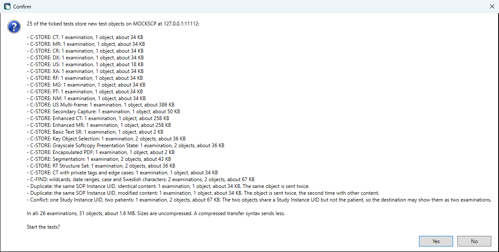

While a run is going, the status bar shows which test is running, what it is doing or waiting for, and for how many seconds, for example `Test 51 of 51: Limit: connection without an association request (ARTIM). Connected without sending an A-ASSOCIATE-RQ. Waiting up to 60 s for the system to close the connection (23 s)`. The command line prints the same as a line of its own.

Beside the buttons are the local AE title and port that C-MOVE and Storage Commitment reports go to. The other settings are in **Test settings...**: the UID root of the objects the tests send, the transfer syntax of the store tests, the Storage Commitment times, see [Storage Commitment](#storage-commitment), and the settings of the Limits tests, see [Limits and faults](#limits-and-faults). They change only when you click OK, and a value that cannot be used is named and nothing is changed. The results folder, which files each run writes and after how many days old results are deleted are under **File > Settings**, on the **Test and Performance Results** tab, see [Result files](#result-files). **Open results folder** opens the folder in Explorer.

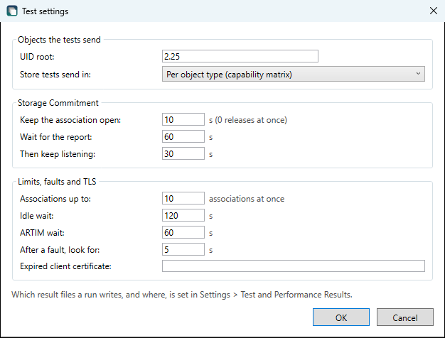

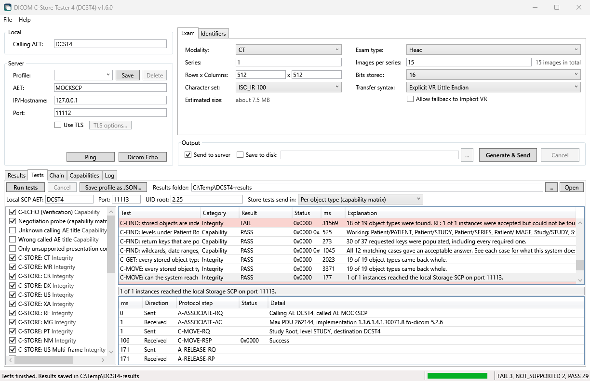

### On the command line

**Save profile as JSON...** on the Tests tab writes the destination to a file, or you can write one yourself. Only `endpoint` is required:

```json
{
  "name": "Test PACS",
  "endpoint": { "host": "pacs.example.org", "port": 104, "callingAe": "DCST4", "calledAe": "PACS" },
  "network": { "connectionTimeoutSeconds": 10, "associationTimeoutSeconds": 10, "responseTimeoutSeconds": 60 },
  "localScpAe": "DCST4",
  "localScpPort": 11113,
  "uidRoot": "2.25"
}
```

For TLS, add `"useTls": true` to `endpoint`, and optionally `"tlsIgnoreCertErrors": true`, `"tlsClientCertThumbprint"` and, for one of the TLS tests, `"tlsExpiredClientCertThumbprint"`, see [Limits and faults](#limits-and-faults).

```powershell
DCST4.Cli.exe run --profile target.json --tests c-echo --out C:\Temp\results
```

The same program makes reports and comparisons of saved runs, with `report` and `compare`, see [Reports and comparison](#reports-and-comparison).

`--tests` takes test ids, categories (`Capability`, `Integrity`, `Limits`, `Performance`) or `all`, separated by commas. `all` leaves out the `Performance` tests, see [Performance](#performance). `--log-dir` chooses another folder for the log. Ctrl+C cancels the run and saves what was finished. A second Ctrl+C ends the program at once. Cancelling while a connection is being opened can take as long as the connection timeout.

**`all` and the `Integrity` category include tests that store objects on the destination**, and those objects may not be possible to delete. Check the profile before running them. `--seed`, `--matrix`, `--transfer-syntax` and `--index-wait` apply to those tests, see [Store, query and retrieve](#store-query-and-retrieve), and `--commit-linger`, `--commit-wait` and `--commit-grace` to the Storage Commitment tests, see [Storage Commitment](#storage-commitment).

**`all` and the `Limits` category include tests that strain the destination and break transfers on purpose**, and that leave up to eight more objects on it. They hold associations open, wait for timeouts and send a PDU that is too long. Read [Limits and faults](#limits-and-faults) before running them against a system that others depend on.

| Exit code | Meaning                                                    |
| --------- | ---------------------------------------------------------- |
| 0         | No `FAIL` or `TOOL_ERROR`                                  |
| 1         | At least one `FAIL` or `TOOL_ERROR`                        |
| 2         | Bad arguments, an unusable profile or results that could not be saved |
| 130       | Cancelled                                                  |

### Result files

Each run can write `DCST4-run-<UTC time>.json` with full detail, a `.csv` with one row per result, and a `.html` report for reading, see [Reports and comparison](#reports-and-comparison). The JSON and CSV files are UTF-8 and independent of the computer's language settings, and they hold a schema version, the tool version, the destination and the start and end time. The client certificate thumbprint is never written to them.

**Which files, and for how long.** These settings are under **File > Settings**, on the **Test and Performance Results** tab, and apply to runs on the Tests and Performance tabs. By default a run writes only its HTML report. The command line always writes all its files, the series files included, and never deletes anything.

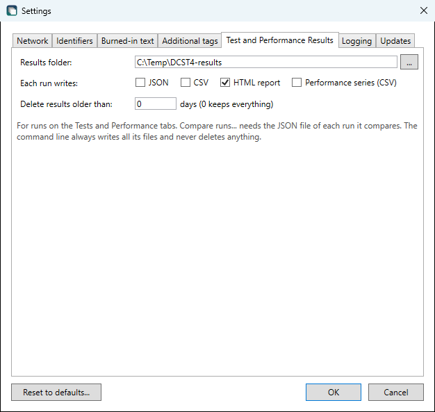

| In Settings, Test and Performance Results | Default | Meaning |
| ---------------- | ------- | ------- |
| Each run writes: JSON | Not ticked | The file with full detail, and the capability matrix as JSON. **Compare runs...** reads this file, so a run saved without it cannot be compared later |
| Each run writes: CSV | Not ticked | The file with one row per result, and the capability matrix and the chain as CSV |
| Each run writes: HTML report | Ticked | The report. Without it, **Open report** makes one from the JSON file when you click it. Without both, the run has no report to open |
| Each run writes: Performance series (CSV) | Not ticked | The files a Performance test writes while it runs, one row per second, and the soak's windows file. Without them a crash during a long soak leaves only what the program shows. The report of the run still has its per-second charts, made from what the program kept in memory, and the chart on the tab, the summary and the soak's windows in the JSON file are not affected |
| Delete results older than | 0 days | After each run, the result files in the results folder that are older than this many days are deleted. 0 keeps everything |

With no box ticked a run writes nothing, and the status bar says so.

**What is deleted** is decided by the name alone: files that lie directly in the results folder, start with `DCST4-run-` or `DCST4-compare-` and end in `.json`, `.csv` or `.html`, which covers the result files, the reports, the comparisons and the series files of the Performance tests. Nothing else in the folder is touched and no subfolder is looked into, since the folder is your own choice and may hold other things. The age is the time the file was last written. It happens only after a run has been saved, never when the program starts or when the setting is changed, and never to the files of the run that was just saved. The status bar says how many files were deleted, and the log has the same. A file that is open in another program is left for the next time.

Two runs of the same tests with the same seed differ only in the times and durations, from the program or the command line alike. A run that generates data draws a new seed unless one is given, and writes it to the JSON file. Without generated data there is no seed, and two identical runs still differ only in the times.

### What the PACS supports

The test `negotiation-probe` asks the PACS what it supports without sending a single image. It proposes every SOP class that DCST4 can generate, plus Verification, Storage Commitment Push Model and Study and Patient Root Query/Retrieve FIND, MOVE and GET, each with 19 transfer syntaxes: uncompressed, Deflated, JPEG, JPEG-LS, JPEG 2000, RLE, HTJ2K and MPEG-4/H.264. Each presentation context holds exactly one transfer syntax, so the answer is per syntax and not only the first one accepted.

An association can hold at most 128 presentation contexts, so the probe splits the work over several associations, 5 by default. Each one is opened with a C-ECHO, whose context takes one of the 128 places. A last association asks about SCP/SCU role selection for the storage classes and extended negotiation for Query/Retrieve. It is separate so that a PACS that objects to those cannot affect the matrix.

The result is on the **Capabilities** tab, with one row per SOP class and one column per syntax, and is saved next to the result files as `<run>-capability.json` and `.csv`. The tab can also save it on its own.

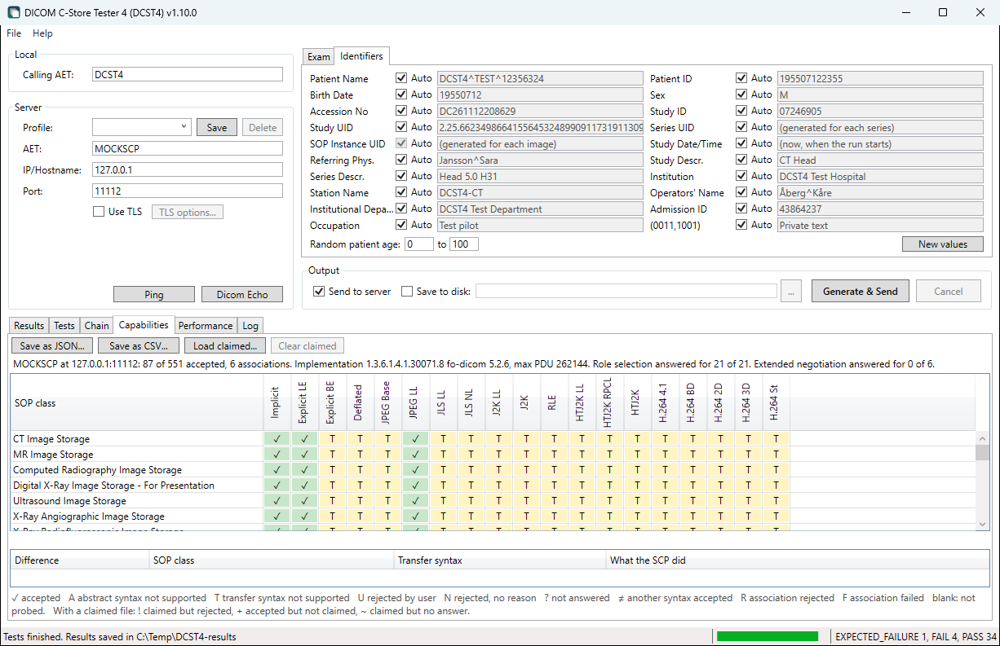

| Cell result                  | Meaning                                                                |
| ---------------------------- | ---------------------------------------------------------------------- |
| `Accepted`                   | The context was accepted with the proposed syntax.                     |
| `AbstractSyntaxNotSupported` | Rejected: abstract syntax not supported.                               |
| `TransferSyntaxNotSupported` | Rejected: transfer syntax not supported.                               |
| `UserRejection`              | Rejected by the user.                                                  |
| `NoReason`                   | Rejected, no reason given.                                             |
| `NotAnswered`                | The association was accepted but the answer has no item for this context, which the standard requires. |
| `AcceptedOtherSyntax`        | Accepted, but with another syntax than the one proposed.               |
| `AssociationRejected`        | The whole association was refused, so the context was never considered. |
| `AssociationFailed`          | The association failed before the PACS answered.                       |
| `NotProbed`                  | The probe never got this far, for example because it was cancelled.    |

The matrix file also holds, per association, how it ended and any reject result, source and reason, and the remote Implementation Class UID, Implementation Version Name and maximum PDU length, as well as the role selection and extended negotiation replies. A PACS that does not answer such an item is recorded as not having answered.

The test is `PASS` when everything was answered and every association was released, and `NOT_SUPPORTED` if nothing was accepted. A rejected or aborted association, or an answer that breaks the rules (`NotAnswered`, `AcceptedOtherSyntax`), gives `FAIL`. A timeout or a connection that fails stops the probe, and the cells not reached are `NotProbed`.

**Claimed vs actual.** **Load claimed...** on the tab reads a JSON file of what the vendor's Conformance Statement claims, in the same layout as the matrix. Only `sopClassUid`, `transferSyntaxUid` and `result` are required, and a saved matrix can be used as a starting point:

```json
{
  "rows": [
    {
      "sopClassUid": "1.2.840.10008.5.1.4.1.1.2",
      "cells": [
        { "transferSyntaxUid": "1.2.840.10008.1.2", "result": "Accepted" },
        { "transferSyntaxUid": "1.2.840.10008.1.2.4.70", "result": "Accepted" }
      ]
    }
  ]
}
```

Only `Accepted` counts as a claim. The tab then lists what was **claimed but rejected**, **accepted but not claimed**, and **claimed but not answered**, the last for a combination the probe never got an answer about, which says nothing about the PACS.

**Tests of refusals.** All three are in the `Capability` category:

| Test                                | What it does                                                              | Result                                                                 |
| ----------------------------------- | ------------------------------------------------------------------------- | ---------------------------------------------------------------------- |
| `negotiation-unknown-calling-ae`    | Calls with an AE title the PACS should not know                           | Rejected: `EXPECTED_FAILURE`, with result, source and reason. Accepted: `FAIL` |
| `negotiation-wrong-called-ae`       | Calls the PACS by the wrong AE title                                      | The same                                                               |
| `negotiation-unsupported-contexts`  | Proposes only an abstract syntax under the profile's UID root, which cannot exist | Rejected, or accepted with the context rejected: `EXPECTED_FAILURE`, and the Details say which. Context accepted: `FAIL` |

A PACS that accepts an unknown AE title gets `FAIL` as a finding to report, with `finding` in the Details, and `DCST4.Cli.exe` then exits with 1. A-ABORT or a closed connection in place of a proper rejection is also `FAIL`, and says so. The two AE title tests first open an association with the profile's own titles, and give `INDETERMINATE` if that fails, since a rejection would then prove nothing.

### Store, query and retrieve

These tests prove, per object type, that what the PACS accepted can be found, can be fetched back and has not changed. They run in this order, and a later test works on what the earlier ones stored in the same run. A test without its input gives `INDETERMINATE` and says what was missing.

**These tests store objects on the destination.** The program asks before a run with any of them. Assume that a PACS cannot delete them. Each object is small, 128 by 128 pixels and marked as a test image, but the duplicate and conflict tests also leave a changed object and a study with two patients behind.

| Test                                 | What it answers                                                                                                                 |
| ------------------------------------ | ------------------------------------------------------------------------------------------------------------------------------- |
| `store-<type>`                       | One for each dataset profile except `tomosynthesis-large`, `store-breast-tomosynthesis` with that object at 128 by 128 and 8 frames, and `store-ct-edge` with private tags and values at maximum length. The Accepted step |
| `query-index`                        | Is each stored instance found with C-FIND at IMAGE level? Waits for a system that indexes in the background. The Indexed step  |
| `query-levels`                       | Which levels work under Patient Root and Study Root. PATIENT under Study Root should be refused                                |
| `query-return-keys`                  | Which of a broad set of return keys come back populated, empty or not at all, and whether they match what was sent             |
| `query-matching`                     | Wildcards, date ranges, case and Swedish characters, on one patient stored in both ISO_IR 100 and ISO_IR 192                    |
| `retrieve-cget`, `retrieve-cmove`    | Does each object type come back? The Retrievable step, which passes if either way works                                        |
| `retrieve-cmove-diagnostic`          | Why a C-MOVE does not arrive                                                                                                    |
| `verify-integrity`                   | Is what came back what was sent? The Intact step                                                                                |
| `duplicate-identical`                | The same SOP Instance UID sent twice                                                                                            |
| `duplicate-modified`                 | The same SOP Instance UID with changed content: which version is kept                                                           |
| `conflict-demographics`              | One Study Instance UID with two patients from the test personnummer list                                                        |

**The transfer syntax** of each store test is chosen per object type: your choice if you made one and the object type allows it, then the first of Explicit VR, Implicit VR and the lossless compressions that the capability matrix says is accepted, otherwise Explicit VR. The matrix comes from `negotiation-probe` in the same run, the Capabilities tab, or `--matrix <file>`. Each store result records in `transferSyntaxSelectedBy` what chose it. A status of Success or Warning is `PASS`, a warning with its raw code. A refused object is `FAIL`, and `0x0122` or a context that was not accepted is `NOT_SUPPORTED`.

**The Chain tab**, the `chain` section of the JSON file and `<run>-chain.csv` give one row per object type, with one result each for accepted, indexed, retrievable, intact and committed. Committed comes from `commit-stored`, see [Storage Commitment](#storage-commitment). Select a row to see the explanation of each step and, per retrieve, each integrity level and what differed.

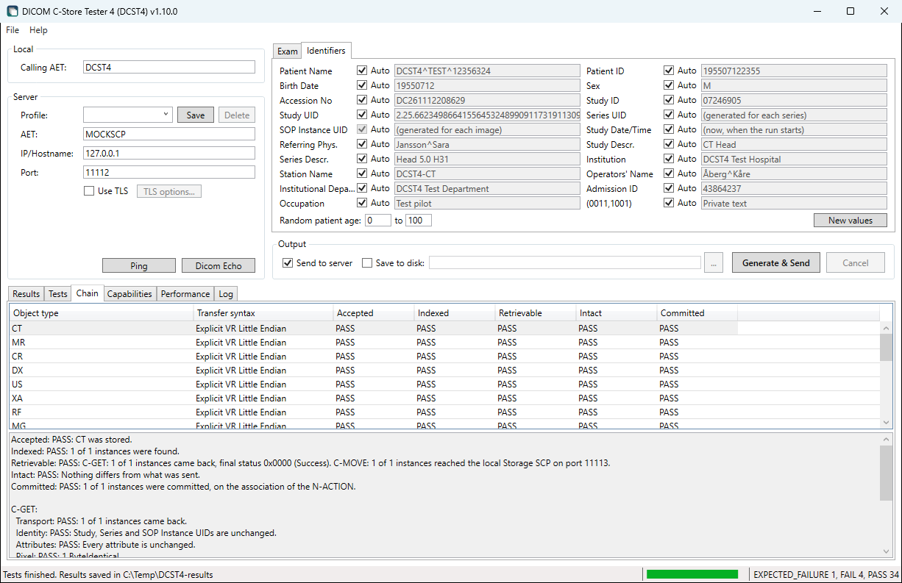

**C-MOVE** makes the PACS connect back to this computer. Add the local AE title (`localScpAe` in the profile, default `DCST4`) on the PACS with this computer's address and the port (`localScpPort`, default 11113), and allow incoming TCP on the port. A PACS that does not know the AE title answers `0xA801`. One that knows it and cannot reach us gets an explanation that names the port and Windows Defender Firewall, a common cause on Windows. In these cases `retrieve-cmove` is `INDETERMINATE`, since it says nothing about the PACS, and it stops after the first object type, since the cause is the same for all of them and a PACS may take its whole connection timeout to answer each one, and `retrieve-cmove-diagnostic` is `FAIL`, so `DCST4.Cli.exe` exits with 1. A port that is already in use is `TOOL_ERROR`. The listener does not use TLS, even if the profile does.

**What Intact checks.** Each retrieved object is compared with the copy that was sent and with the manifest, reported per level:

| Level           | Result                                                                                                                                                                         |
| --------------- | ------------------------------------------------------------------------------------------------------------------------------------------------------------------------------ |
| Transport       | All instances came back and the counts match                                                                                                                                   |
| Identity        | Study, Series and SOP Instance UIDs are unchanged                                                                                                                              |
| Attributes      | Tag by tag. A change recorded in Original Attributes Sequence (0400,0561) is a documented coercion. Without that it is a silent modification, and `FAIL`                        |
| Pixel           | `ByteIdentical`, `LosslessEquivalent` (the same decoded pixels in another syntax), `LossyChanged` with the largest and mean absolute difference, or `Corrupt`                    |
| Transfer syntax | What was sent, offered and returned. Whether a PACS transcodes on store or on retrieve can only be inferred from outside, and the explanation says what is known                |

Reported separately under Attributes: private tags kept and dropped (a dropped one is `FAIL`), character set changes, truncated values, attributes the PACS added (not a failure), attributes sent empty and dropped, and the VR lost when a private element comes back as UN. A private sequence that comes back as UN bytes is marked as not compared.

**Duplicates and conflicts.** A refusal with `0x0111`, or of the conflicting patient, is `EXPECTED_FAILURE`. For changed content the result says which version was kept, per attribute and pixels, and attributes of one version with pixels of the other is `FAIL`. Two patients kept in one study without any change is `FAIL` with `finding` in the Details, as a finding to report.

```powershell
DCST4.Cli.exe run --profile target.json --tests Integrity --out C:\Temp\results --seed 42 --index-wait 60
```

| Option                 | Meaning                                                                                                     |
| ---------------------- | ----------------------------------------------------------------------------------------------------------- |
| `--seed`               | Fixes the generated data. The same seed repeats the same UIDs, which on a real system are duplicates        |
| `--matrix`             | A saved capability matrix to choose the transfer syntax from                                               |
| `--transfer-syntax`    | Send everything in this syntax where the object type allows it: the names from `generate`                  |
| `--index-wait`         | How long an object may take to appear in a query, in seconds. Default 30                                    |

The command line keeps the files that were sent and retrieved under the `--out` folder in `work-<time>`. The program uses a temporary folder and removes it when the run ends. The folder holds only test data.

### Storage Commitment

A C-STORE that succeeds says that the PACS received an object, not that it will keep it. Storage Commitment Push Model asks for that promise: DCST4 sends an N-ACTION (Request Storage Commitment, Action Type 1) with a Referenced SOP Sequence of instances stored earlier in the run, and the PACS answers later with an N-EVENT-REPORT. The two tests run after `verify-integrity`, need a store test before them in the same run, and send no objects of their own.

| Test                      | What it asks for                                                                  | Result                                                                                                  |
| ------------------------- | --------------------------------------------------------------------------------- | ------------------------------------------------------------------------------------------------------- |
| `commit-stored`           | Every instance stored in the run, in one transaction. The Committed step of the chain | `PASS` if Event Type 1 and all are committed. `FAIL` if any is not, with its Failure Reason            |
| `commit-unknown-instance` | The instances of the smallest stored object type, plus one SOP Instance UID under the profile's root that no test stored | `EXPECTED_FAILURE` if that one fails with a Failure Reason and the rest are committed. Reported as committed: `FAIL`, as a finding |

**Where the report comes.** The PACS may send the N-EVENT-REPORT on the association of the N-ACTION, if it is still open, or open a new association to the local SCP, the same AE title and port as for C-MOVE. Both are accepted and the result says which was used, in `reportVia`. A report on a new association needs the PACS to know the local AE title with this computer's address and port, and Windows Defender Firewall to allow incoming TCP on the port. The SCP role that the PACS proposes for it is accepted.

| In Test settings           | Command line        | Default | Meaning                                                                                                    |
| -------------------------- | ------------------- | ------- | ---------------------------------------------------------------------------------------------------------- |
| Keep the association open  | `--commit-linger`   | 10 s    | How long the association of the N-ACTION stays open after its response, so that the report can come on it. It stays open that long even if the report comes sooner. 0 releases it at once, as many modalities do |
| Wait for the report        | `--commit-wait`     | 60 s    | How long the report may take after the N-ACTION-RSP. It cannot be shorter than the time the association is kept open |
| Then keep listening        | `--commit-grace`    | 30 s    | How much longer DCST4 listens after a timeout                                                             |

**No report in time** is `TIMEOUT`. DCST4 keeps listening for the grace period, and the explanation says whether the report came later and on which association, or not at all. A late report is answered with `0x0000`, since DCST4 issued its Transaction UID, and its content is recorded. The timeout counts from the N-ACTION-RSP, and the N-ACTION-RSP itself is under the profile's response timeout.

**What is recorded**, in the `commitment` section of the test's result: the Transaction UID, the settings, the raw N-ACTION-RSP status, which association the report came on and from which AE title, the Event Type, `reportAfterMs` from the N-ACTION to the report on the monotonic clock, and per instance `Committed`, `Failed` with the Failure Reason as `0xNNNN` and its meaning, `NotReported` or `ListedTwice`. The timeline shows our association and each one the PACS opened, with the N-EVENT-REPORT and our response.

**Rules the report must follow.** Every instance asked for in exactly one of the two lists, nothing that was not asked for, a Failure Reason for each failure, Event Type 1 only without failures and 2 only with them. A report that breaks one is `FAIL` with `finding` in the Details.

**What DCST4 refuses.** An N-EVENT-REPORT whose Transaction UID DCST4 did not issue, or that has none, is answered with `0x0110` Processing Failure and the Error Comment `Unknown Transaction UID`, and is listed in `rejectedReports`. An Event Type other than 1 or 2 gets `0x0113`. Neither ends the wait for the real report. A report while no commitment is outstanding is refused the same way.

**Other results.** A Storage Commitment Push Model context that is not accepted, or an N-ACTION-RSP of `0x0123` or `0x0211`, is `NOT_SUPPORTED`. Any other N-ACTION-RSP than `0x0000` is `FAIL`. A port that is already in use is `TOOL_ERROR`. The Transaction UID follows from the seed and the profile's UID root, so the same seed repeats it.

```powershell
DCST4.Cli.exe run --profile target.json --tests store-ct,commit-stored,commit-unknown-instance --out C:\Temp\results --commit-linger 0
```

### Limits and faults

These tests find the limits of the PACS and show what it does when a transfer goes wrong. They are in the `Limits` category, come last in a run and depend on no other test. They hold associations open on the PACS, break transfers on purpose and take minutes with the default waits, so tick only the ones you want, in the TLS, Limits and Faults groups on the Tests tab, or use `--tests Limits` or the test ids on the command line.

| Test                         | What it does                                                                                                   | Result                                                                                                             |
| ---------------------------- | -------------------------------------------------------------------------------------------------------------- | ------------------------------------------------------------------------------------------------------------------ |
| `tls-association`            | C-ECHO with the profile's TLS settings                                                                         | `PASS` with the TLS version and cipher, read from the session                                                      |
| `tls-server-certificate`     | Checks the PACS's own certificate strictly, even when the profile accepts certificate errors                   | `PASS`, or `FAIL` that names a hostname mismatch, a chain that is not trusted on this computer, or both            |
| `tls-client-cert-wrong-ca`   | Presents a client certificate from an authority that DCST4 makes up for the test                               | Refused: `EXPECTED_FAILURE`. Accepted: `FAIL`, as a finding. The PACS asks for no client certificate: `NOT_SUPPORTED` |
| `tls-client-cert-expired`    | Presents an expired client certificate that the profile names                                                  | The same. No certificate named: `NOT_SUPPORTED`. Named but not found, or not expired: `TOOL_ERROR`                 |
| `limit-max-pdu`              | Four associations where DCST4 announces a maximum PDU length of 4096, 16384, 65536 and 131072. On each it stores one CT image of 256 by 256 in data PDUs of exactly the length the PACS announced | Stored every time, and nothing the PACS sent was longer than DCST4 announced: `PASS`. Refused or broken off: `FAIL` |
| `limit-oversized-pdu`        | Stores one CT image in data PDUs 1024 bytes longer than the PACS announced                                     | Aborted, closed or refused with a status: `EXPECTED_FAILURE`. Stored: `FAIL`, as a finding. A PACS that announces 0, no limit: `INDETERMINATE` |
| `fault-abort-mid-dataset`    | Sends half of a 2 MB CT image and then an A-ABORT                                                              | See below                                                                                                          |
| `fault-drop-mid-dataset`     | Sends half of it, stops in the middle of a PDU and resets the TCP connection, with no A-ABORT                  | See below                                                                                                          |
| `fault-drop-before-response` | Sends all of it and closes the connection without reading the C-STORE response                                 | See below                                                                                                          |
| `limit-max-associations`     | Opens associations one at a time and holds them, until one is refused or 10 are open. Sends a C-ECHO on each at the end, then releases them all | Refused with A-ASSOCIATE-RJ: `EXPECTED_FAILURE`, with the limit and the result, source and reason, such as `LocalLimitExceeded`. All 10 held: `PASS`, the limit is higher. Refused with A-ABORT or a closed connection: `FAIL`, as a finding. No answer: `TIMEOUT` |
| `limit-idle-timeout`         | Opens an association and sends nothing for up to 120 s                                                         | `PASS` either way. Records how the PACS ended it (A-ABORT, A-RELEASE-RQ or a closed connection) and after how long, or that it was still open |
| `limit-artim`                | Connects, with TLS if the profile has it, and never sends an A-ASSOCIATE-RQ, for up to 60 s                    | Closed by the PACS: `PASS`, with the time. Still open: `FAIL`, as a finding, since such connections can use up what the PACS has |

**After each fault** the test asks with C-FIND whether the instance is there, for 5 seconds, and if it is, gets it back with C-GET or C-MOVE and compares the pixels with what was sent. The state is `None`, `Partial`, `Complete`, `PresentUnverified` if it could not be retrieved, or `Unknown` if the query did not work. Then it sends the whole object again on a new association, as a modality does after a lost connection, and records whether the retry was stored, stored with a warning, refused with `0x0111` Duplicate SOP Instance, or refused with something else. Last it asks again.

| What the PACS did                                                              | Result               |
| ------------------------------------------------------------------------------ | -------------------- |
| Kept nothing or a complete object, and stored the retry                        | `PASS`               |
| Refused the retry with `0x0111` for an instance it holds                       | `EXPECTED_FAILURE`   |
| Kept a partial object                                                          | `FAIL`, as a finding |
| Refused the retry with `0x0111` although a query does not find the instance    | `FAIL`, as a finding |
| Refused the retry with another status, or stored it and still cannot find it   | `FAIL`               |

The instance of a fault test follows from the seed. If it is already on the PACS, from an earlier run with the same `--seed`, the test gives `INDETERMINATE` and sends nothing.

**What is left on the PACS**: four CT images of about 130 KB from `limit-max-pdu`, one from `limit-oversized-pdu` if the PACS takes it, and one of 2 MB from each fault test. All are marked as test images, with a Patient ID from the test personnummer list and UIDs under the profile's root. The other tests store nothing.

**The TLS tests** give `INDETERMINATE` if the profile does not use TLS. The two client certificate tests first open an association with the profile's own settings, and give `INDETERMINATE` if that fails, since a refusal would then prove nothing. The certificate from an unknown authority is made in memory and is never put in a certificate store. Windows needs its private key in a key container to use it, so one exists in your profile while the test runs and is removed afterwards. An expired certificate is only a fair test if it comes from an authority the PACS trusts, so DCST4 cannot make one: install one yourself in your personal certificate store and give its thumbprint in **Expired client certificate** in Test settings on the Tests tab, or as `tlsExpiredClientCertThumbprint` in the profile's `endpoint`. Neither thumbprint is written to the result files. A PACS on TLS 1.3 may refuse a certificate only after the handshake, by closing the connection, and that counts as refused. `tls-server-certificate` reports on the PACS's certificate as this computer sees it, so a certificate from an internal authority that is not installed here is reported as not trusted.

**Why these tests do not use fo-dicom's client.** It cannot stop in the middle of a dataset, cannot hold a connection without sending an A-ASSOCIATE-RQ, closes an association when it has nothing to send, and does not show the length of the PDUs on the wire. So these tests, and only these, write and read the PDUs themselves on a socket of their own (`RawAssociation`). `tls-association` is the exception: it goes through fo-dicom, so that the TLS version it reports is the one an ordinary send gets.

**What is recorded**, in the `limits` section of the test's result: the limit found and how the next association was refused, how and after how many milliseconds (`endedAfterMs`, on the monotonic clock) an idle association or connection was ended, each PDU attempt with both announced lengths and the longest PDU sent and received, the fault with the bytes sent, the state after it, the retry and the state after that, and for TLS the version, cipher and what was wrong with the server certificate. Measured times are in `endedAfterMs` and on the timeline, never in the explanation.

Every test releases or aborts what it opened, also when the run is cancelled.

| In Test settings           | Command line           | Default | Meaning                                                                                       |
| -------------------------- | ---------------------- | ------- | --------------------------------------------------------------------------------------------- |
| Associations up to         | `--max-associations`   | 10      | Where `limit-max-associations` stops if none is refused. 1 to 500. They are held open on the PACS, so keep it small |
| Idle wait                  | `--idle-wait`          | 120 s   | How long `limit-idle-timeout` waits                                                           |
| ARTIM wait                 | `--artim-wait`         | 60 s    | How long `limit-artim` waits                                                                  |
| After a fault, look for    | `--fault-settle`       | 5 s     | How long a fault test goes on asking for the instance before it counts as not there. Raise it for a PACS that indexes slowly |

```powershell
DCST4.Cli.exe run --profile target.json --tests limit-max-associations,limit-artim --out C:\Temp\results --max-associations 20 --artim-wait 90
```

### Performance

Three tests measure throughput and latency: `load-throughput`, `load-ramp` and `load-soak`, in the `Performance` category. **Every image they send is a new object on the destination, and a PACS may not be able to delete it.** So they are not part of `all`. Name them, or use `--tests Performance`. In the program they have a tab of their own, **Performance**, and are not listed on the Tests tab. Before anything is sent, DCST4 says how many objects the run will store at most and about how much data that is. The program asks for a yes with the destination's AE title, host and port in the question, and the command line prints it:

```
Plan for the load test: Stores up to 5,000 new objects (about 675 MB, mix ct) on PACS at pacs.example.org:104. A system that stores more than 250 objects per second has stored all 5,000 (Max instances) before the 20 s are up, and the run ends early. Set a rate, or raise Max instances, to measure the whole 20 s.
```

| Test              | What it does                                                                                       | Result |
| ----------------- | -------------------------------------------------------------------------------------------------- | ------ |
| `load-throughput` | N associations at once, for a duration or a number of instances, optionally at a fixed rate       | `PASS` if everything was stored. `FAIL` for failure statuses, a C-STORE without a response, an association the PACS ended while a C-STORE was outstanding, or a rejected association |
| `load-ramp`       | 1, 2, 4, 8 ... associations in turn, a step at a time, to find where more associations stop helping | `PASS` when the ramp reached an answer, saturated or not. `FAIL` when errors came before saturation. Errors at or after the saturation step are part of the answer |
| `load-soak`       | Steady load at a fixed rate for a long time, with a snapshot written to disk as it goes            | `FAIL`, as a finding, when the PACS got worse over the soak or errors appeared. `PASS` otherwise. `INDETERMINATE` with fewer than three snapshot windows |

For all three, a SOP class or transfer syntax that is not accepted is `NOT_SUPPORTED`, a PACS that answers nothing is `TIMEOUT`, a cancel is `INDETERMINATE`, and a codec that is not available on this computer is `TOOL_ERROR`.

**How it sends.** Each association has a worker of its own, and one C-STORE outstanding at a time, as most modalities send. Before the first send, the objects of the mix are generated and encoded in its transfer syntax, four per object type, so no transcoding or generation happens while the clock runs. Each send gets new UIDs under the profile's UID root: a new SOP Instance UID every time, and a new Study and Series Instance UID and Frame of Reference, an Accession Number and Series and Instance Numbers per 500 sends of one worker. The UIDs also hold a value drawn for each run, so two runs never send the same UID, even with the same `--seed`. The patient is one from the test personnummer list, the same for the whole run, and is named in the result's `details`, so the objects can be found on the PACS. Only the attributes are encoded again per send: the pixel data is encoded once and every send uses the same bytes. The workers write the DICOM PDUs themselves, with `RawAssociation`, the same code as the Limits tests, because fo-dicom's client does not show when a request goes on the wire and encodes the whole dataset again for every send. Nothing is logged per image. The first ten problems are written to the log, then they are only counted. The first of them, with its raw status, Error Comment or the lack of one, and the second of the run it happened in, is also in the result's `details` as `firstProblem`.

**What is measured**, on the monotonic clock:

| Metric                  | Definition |
| ----------------------- | ---------- |
| C-STORE latency         | From just before the first byte of the C-STORE-RQ is written until the whole C-STORE-RSP command has been received. With one C-STORE outstanding per association, nothing waits inside DCST4 in that time. It includes sending the dataset |
| Response wait           | From the last byte of the dataset handed to the socket until the response. A write finishes when Windows has taken the bytes, so for a large object part of the transfer is counted here |
| Association setup       | From starting the TCP connection until the A-ASSOCIATE-AC, and on its own the connection with any TLS handshake |
| Stored per second, MB/s | C-STOREs answered with Success or Warning, per second of the measured window, and the bytes of their datasets on the wire. 1 MB is 1,000,000 bytes |
| Errors per status class | Success, Warning, Failure and Cancel from the raw status, each raw status with its count, and no response, association lost, association rejected and connection failed |

Percentiles are p50, p95, p99 and the maximum, by nearest rank. They come from a histogram in microseconds that is exact below 0.5 ms and at most 0.4 % below the true value above that, and the maximum is exact. That keeps memory fixed in a soak of many hours. The first `--load-warmup` seconds, 2 by default, of a run and of each ramp step are in the time series but not in the throughput and latency of the summary. The errors count from the start.

**Saturation**, in the ramp, is the first step where throughput rises less than 10 % over the best step before it, p95 latency is more than twice that of step 1, or the error rate rises by more than 1 percentage point or an association is lost. The result names the step, the reason and the step with the highest throughput. The thresholds are fixed in this version, and the result records them in its settings.

**Degradation**, in the soak, compares the end with the start. The first snapshot window is a warm-up. The baseline is the mean of the next 10 % of the windows, at least one, and the end the mean of the last 10 %. The soak counts as degraded when the least-squares trend of p95 latency rises by more than 50 % over the soak and the end is more than 50 % and at least 5 ms above the baseline, when the end's throughput is more than 20 % below the baseline, or when errors appear after an error-free baseline. A last window shorter than half the snapshot interval is left out, since its throughput would come from a few samples.

**Time-to-available**: for 1 in `--tta-sample` stored instances, 50 by default, DCST4 asks with C-FIND at IMAGE level under Study Root, with the Study, Series and SOP Instance UID, every `--tta-interval` seconds until the instance is found or `--tta-timeout` seconds have passed. It uses an association of its own per round and at most 10 queries a round, and none of this is in the load metrics. The time runs from the C-STORE-RSP to the C-FIND response that finds the instance, so its resolution is the interval. The result has p50, p95 and the maximum, how many were found, and how many never were. A PACS that does not accept C-FIND gets a note there, and the load test's own result is unchanged. The ramp does not poll, so polling cannot shift where saturation is found.

**Data mixes**, shown by `DCST4.Cli.exe list-mixes`:

| Mix              | What is sent |
| ---------------- | ------------ |
| `ct` (default)   | CT 256 x 256, 16 bits, Explicit VR LE, about 130 KB each |
| `small`          | Many small objects: CR 512 x 512 and US 800 x 600, in turn, Explicit VR LE |
| `small-lossless` | The same in JPEG Lossless (Process 14 SV1) |
| `large`          | Few large objects: Enhanced CT 512 x 512 x 32 frames (16 MB) and Breast Tomosynthesis 1024 x 1024 x 16 frames (32 MB) |
| `large-lossless` | Enhanced CT 512 x 512 x 32 frames in JPEG Lossless |
| `custom`         | The object described on the Exam tab. In the program only |

**The custom mix** takes Modality, Object, Rows x Columns, Bits stored, Frames per image, Transfer syntax and the private payload from the Exam tab, and nothing else: a load run makes its own studies and patient, as with the other mixes, so Exam type, Series, Images per series, the Identifiers tab and burned-in text are not used. The text beside the list, the plan, the question before the run, the result file and the report all say what it was, for example `US Multi-frame 960 x 1280, 8 bits, 270 frames, JPEG Baseline (Process 1, lossy), 100 MB private payload`. A load run keeps its objects in memory, encoded, so one object can be at most 1 GB, and the pool holds four variants of an object only while they fit in 1 GB together, down to one. Each variant is generated and encoded before the run starts, which takes minutes for a long cine loop. A larger object stops the run before anything is sent; send that one with Generate & Send. Two runs with the custom mix are compared only if their descriptions are the same. With a large object, lower Max instances first: the default of 5,000 times a 700 MB object is 3.5 TB.

`--load-pdu` sets the maximum PDU length that DCST4 announces and sends its data PDUs with, at most what the PACS announces. 0, the default, is fo-dicom's default of 262144, which an ordinary send uses.

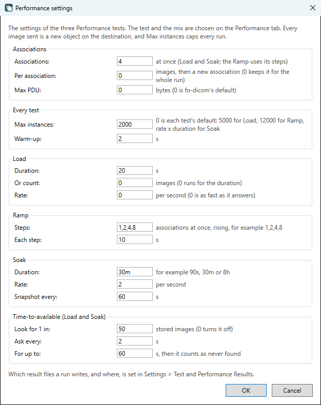

| In Performance settings        | Command line                  | Default | Meaning |
| ------------------------------ | ----------------------------- | ------- | ------- |
| Associations                   | `--load-associations`         | 4       | Associations open at the same time, each with one C-STORE in flight: what loads the PACS. 1 to 256. In the ramp, the steps decide |
| Duration                       | `--load-duration`             | 20 s    | How long `load-throughput` runs. `90`, `90s`, `5m` and `1h` all work |
| Count                          | `--load-count`                | 0       | Send exactly this many instead. 0 runs for the duration |
| Rate                           | `--load-rate`                 | 0       | Instances per second over all associations. 0 sends as fast as the PACS answers. A late worker sends at once and does not burst to catch up |
| Per association                | `--load-per-association`      | 0       | How many images an association sends before it is released and a new one is opened in its place. It never changes how many are open at once, and tests association setup under load. With 4 associations and 1000 images, 0 opens 4 in all, 50 about 20, and 1 opens one per image |
| Mix (on the tab)               | `--load-mix`                  | `ct`    | See above |
| Max PDU                        | `--load-pdu`                  | 0       | See above |
| Warm-up                        | `--load-warmup`               | 2 s     | Left out of the summary |
| Max instances                  | `--load-max-instances`        | 0       | The ceiling of the run. 0 is the default of each test: 5000, 12000 for the ramp, and the rate times the duration for the soak. A value you set applies to all three tests |
| Steps                          | `--ramp-steps`                | 1,2,4,8 | Associations per ramp step, rising |
| Each step                      | `--ramp-step-duration`        | 10 s    | How long each ramp step runs |
| Duration (soak)                | `--soak-duration`             | 30m     | How long the soak runs |
| Rate (soak)                    | `--soak-rate`                 | 2       | Instances per second during the soak. A soak needs one |
| Snapshot every                 | `--soak-snapshot`             | 60 s    | How often a window is closed and written |
| Time-to-available              | `--tta-sample`, `--tta-interval`, `--tta-timeout` | 50, 2 s, 60 s | See above. 0 turns the polling off |

**Planned total.** A count is exact. Otherwise the plan is the ceiling, or the rate times the duration if that is lower, and the size is that times the uncompressed size of the mix, an upper bound for a compressed mix. With the defaults, `load-throughput` stores at most 5000 CT images of 130 KB, 675 MB, `load-ramp` at most 12000, 1.6 GB, and `load-soak` 3600 in its 30 minutes. A system that stores images faster than the ceiling divided by the duration, 250 per second with the defaults, reaches the ceiling before the duration is over, and the plan says so. The run then ends early: the result has `endedByCeiling`, the explanation says that throughput and latency come from a shorter window than asked for, and the Note in the table on the Performance tab says so. Raise the ceiling, shorten the duration or set a rate.

**Files.** Besides the usual result files, each test writes `DCST4-run-<start>-<test id>.csv` while it runs, with one row per second: stored, failed, bytes, MB/s, latency p50, p95 and maximum, open associations, how busy this computer's processor was, and whether the second is the last of a run or ramp step and so shorter than a second (`partial`). The steps of a ramp follow each other in it without the moment between them when associations are released and opened again. The soak also writes `DCST4-run-<start>-load-soak-windows.csv`, one row per snapshot window, and both files are written through to the disk at each snapshot, so a crash or a power cut keeps what was measured. The command line writes them under `--out`, and the program in the results folder set under **File > Settings**, when **Performance series (CSV)** is ticked there. Without the file, the report made right after the run draws the per-second chart from memory. The `performance` section of the JSON file holds the settings, the plan, why the run stopped, whether the ceiling ended it early, the summary, the steps and the saturation, the windows and the degradation, the time-to-available, and the state of this computer. The explanation never holds a measured number.

**On the Performance tab** the chart shows stored and failed per second above and latency p50 and p95 below. It is drawn by DCST4 itself, as two line charts, and updated at most once a second. The warm-up is shaded and labelled, ramp steps are marked and their lines are not joined, a last second shorter than a second is left out of the lines and of the scale, and hovering shows the values of one second. A soak longer than 600 seconds is drawn in buckets, with the mean of the counts and the highest p95 of each bucket, so a peak is not lost. When the run is over, the table below the chart has one row for the run, one per ramp step with the saturated step marked, or one per soak window.

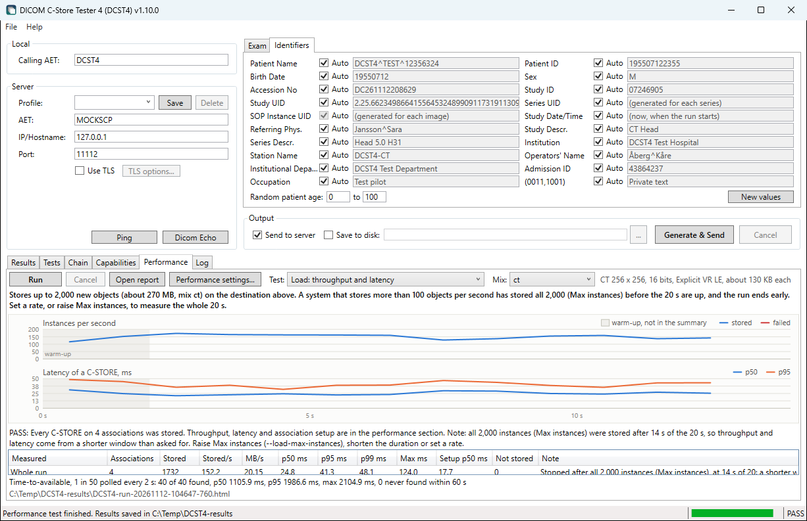

**This computer.** The worker of each association waits on the network without holding a thread, but a TLS handshake does hold one. So while a test runs, DCST4 raises the thread pool's minimum to twice the number of associations plus eight. Otherwise the setup times at a step of 16 or 32 associations would include the wait for new threads. It also asks the garbage collector for `SustainedLowLatency`, which keeps blocking full collections out of the measurement, and puts both settings back afterwards. `DCST4.Cli.exe` runs with workstation GC and background collection, set in `DCST4.Cli.exe.config`, because the tests allocate little while they measure: the pool is encoded in advance and each association reuses one buffer for its PDUs. Server GC would add a heap and a GC thread per processor for no gain. The result records the processor use per second, the garbage collections per generation, the GC mode and the thread pool minimum, so that a busy client can be told from a slow PACS.

```powershell
DCST4.Cli.exe run --profile target.json --tests load-ramp --out C:\Temp\results --ramp-steps 1,2,4,8,16 --ramp-step-duration 20 --load-max-instances 3000
DCST4.Cli.exe run --profile target.json --tests load-soak --out C:\Temp\results --soak-duration 8h --soak-rate 5 --load-associations 2
```

### Reports and comparison

**The report.** Every run writes `DCST4-run-<UTC time>.html` beside its JSON file, from the program and from the command line alike. **Open report** on the Tests tab and on the Performance tab opens the report of the last run in the browser. `DCST4.Cli.exe report` makes it again from a saved JSON file, also one from an earlier version of DCST4:

```powershell
DCST4.Cli.exe report --run C:\Temp\results\DCST4-run-20261111-134244-300.json
DCST4.Cli.exe report --run old-run.json --out C:\Temp\old-run.html
```

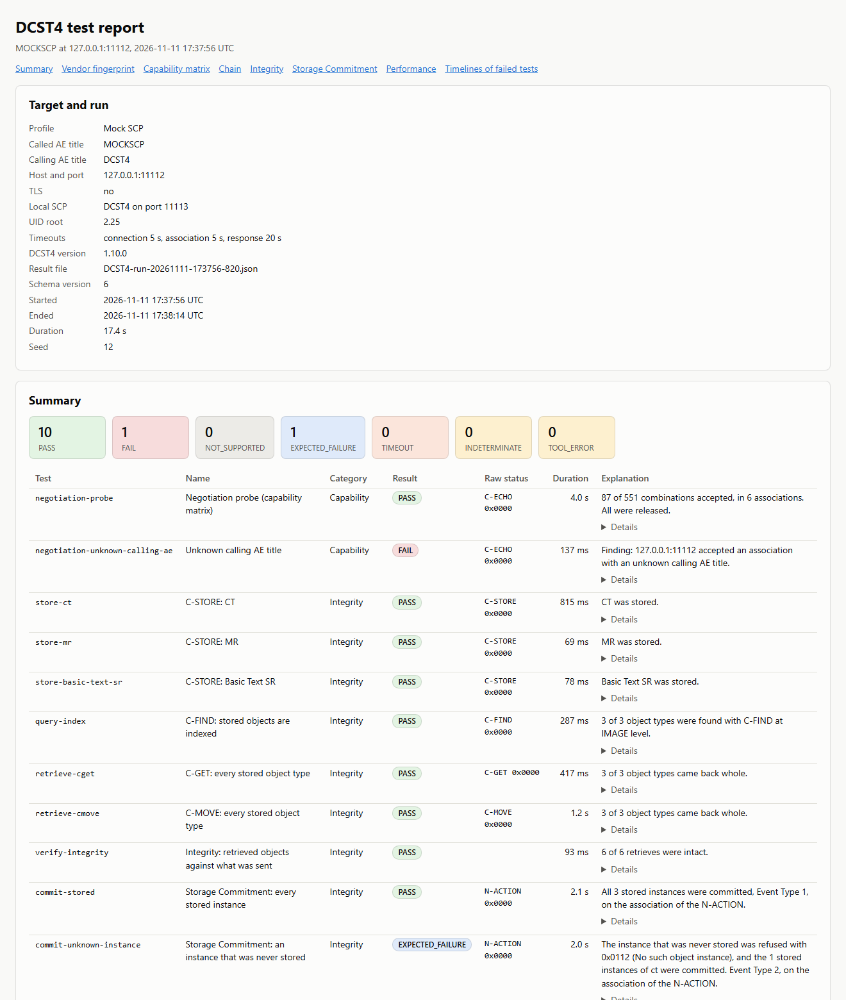

The report is one file that is complete in itself, so it can be mailed, archived or attached to a ticket as it is. It has its style sheet inside, **no script at all**, and loads no font, image or style sheet from anywhere. Its heading and its last line name the program in full, DICOM C-Store Tester 4 (DCST4), for a reader who has never seen it, and the last line links to this project on GitHub. That link is the only address in the page that leaves it, and nothing is fetched from it unless someone clicks it. It holds:

| Section | What it shows |
| ------- | ------------- |
| Target and run | The destination, the DCST4 version, the schema version, the times and the seed |
| Summary | The number of results of each class, and every test with its raw statuses, its explanation and, folded, its details and UIDs |
| Vendor fingerprint | See below |
| Capability matrix | SOP classes against transfer syntaxes, with the associations of the probe and the role selection and extended negotiation replies folded |
| Chain | Accepted, indexed, retrievable, intact and committed per object type, with the explanation of each step that did not pass |
| Integrity | Each level per object type and retrieve, the pixel verdict with the largest and mean difference, what was transcoded, and the attribute differences, at most 200 per set. Attributes that the PACS only added are counted |
| Limits, faults and TLS | The association limit and how the next one was refused, how idle associations and connections were ended, the PDU attempts, each fault with the state after it and the retry, and the TLS session |
| Storage Commitment | The N-ACTION status, where the report came and after how long, the Event Type, each instance that was not committed with its Failure Reason, and the reports that DCST4 refused |
| Performance | The settings, the plan, the tables, and charts as inline SVG: stored and failed per second and latency p50 and p95 for a load run, throughput and p95 latency per step for a ramp, and per window for a soak |
| Timelines | Every protocol step of each test that ended in `FAIL`, `TIMEOUT` or `TOOL_ERROR`, at most 300 steps per test |

The chart of a `load-throughput` run is drawn from its series file, `DCST4-run-<start>-load-throughput.csv`, so keep that file beside the JSON file. Without it the report says so and has the tables only. The charts of a ramp and a soak come from the JSON file itself.

**Text from the PACS is shown as text.** Much of a result comes from the system under test: Error Comments, AE titles, version names, attribute values. Everything in the report is HTML-encoded on the way in, so markup in an Error Comment appears as the characters it is and is never run or fetched. The report also carries a Content-Security-Policy that allows nothing but its own style sheet, as a second line of defence.

**Vendor fingerprint.** A table of who answered and how it behaves, as opposed to whether each test passed. It is meant for comparing versions and vendors, for example in a procurement. Each row names the test it came from, and says `not tested` when no test of the run could tell, so the fingerprint is as complete as the run.

| Group | What it says |
| ----- | ------------ |
| Identity | Implementation Class UID, Implementation Version Name and the maximum PDU length the system announces. From `negotiation-probe`, or without it from the first association of any test |
| Negotiation | How many SOP classes and combinations it accepts and in which transfer syntaxes, answers that break the negotiation rules, SCP/SCU role selection, extended negotiation, and whether an unknown calling or a wrong called AE title is refused |
| Storage and retrieve | Whether objects come back in the transfer syntax they were sent in and where it transcodes, attributes changed with and without Original Attributes Sequence, attributes it adds, private attributes, Specific Character Set, pixel data, C-GET and C-MOVE, and what it does with a duplicate, changed content and two patients in one study |
| Storage Commitment | Whether it is supported, on which association the report comes, how long it took, and what it says about an instance that was never stored |
| Limits and faults | The number of simultaneous associations and how the next one is refused, how and when an idle association and a connection without a request are ended, whether it keeps to the maximum PDU length, what it keeps after each kind of broken transfer and how it takes the retry, and the TLS version and cipher |
| Performance | Throughput and p95 latency of `load-throughput`, and where `load-ramp` found saturation |

Measured times, such as the idle timeout or the throughput, are marked as measured.

**Comparing runs.** **Compare runs...** on the Tests tab opens a list of saved runs. **Add...** chooses result files from the results folder, the run at the top is the baseline, and **Move up** and **Move down** change the order. **Compare** compares each of the other runs with the baseline, writes `DCST4-compare-<UTC time>.html` to the results folder and opens it. **Open report** in the same window opens the report of the selected run. On the command line:

```powershell
DCST4.Cli.exe compare --runs before.json after.json
DCST4.Cli.exe compare --runs baseline.json monday.json tuesday.json --threshold 20 --out C:\Temp\week.html
```

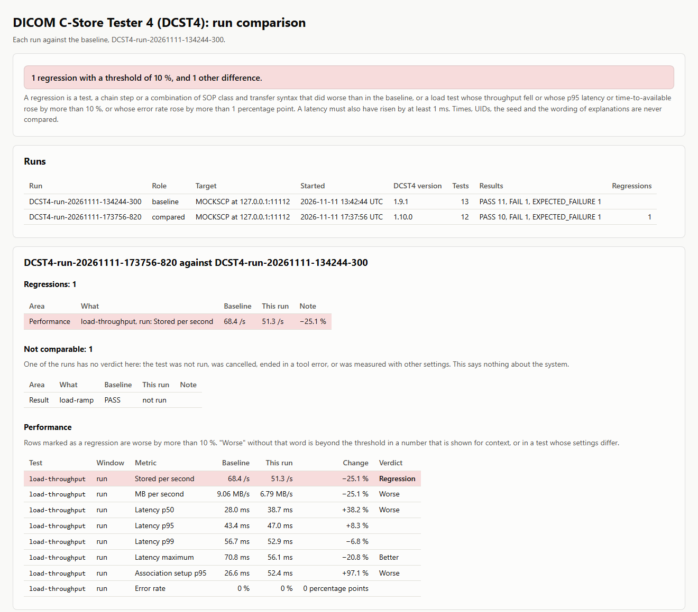

`--threshold` is in percent, 10 by default, more than 0 and at most 1000. Without `--out` the page is written to the folder of the last run. Each line of the output is one difference, and the last line counts them:

```
Baseline: before: PACS at pacs.example.org:104, 2026-11-10 08:00:12 UTC, DCST4 1.10.0, 14 tests

Compared: after: PACS at pacs.example.org:104, 2026-11-11 08:00:09 UTC, DCST4 1.10.0, 14 tests
  REGRESSION      Capability: CT Image Storage: Accepted -> no longer accepted: JPEG LL (TransferSyntaxNotSupported) (1.2.840.10008.5.1.4.1.1.2)
  REGRESSION      Performance: load-throughput, run: Latency p95: 31.2 ms -> 93.6 ms (+200.0 %)

2 regressions with a threshold of 10 %.
```

| Exit code of `compare` | Meaning |
| ---------------------- | ------- |
| 0 | No regression |
| 1 | At least one regression |
| 2 | Bad arguments, fewer than two runs, or a file that cannot be read or written |

`report` returns 0 when the report is written and 2 otherwise. It does not look at the results of the run.

**What is compared.** Tests are matched by their id, object types by their name, cells of the capability matrix by SOP class and transfer syntax, and ramp steps by their number of associations. Each difference is one of four kinds:

| Kind | What it is |
| ---- | ---------- |
| Regression | A test or a chain step that did worse: the result classes rank as `PASS` and `EXPECTED_FAILURE`, then `NOT_SUPPORTED`, then `FAIL` and `TIMEOUT`, and a move down is a regression |
| | A combination of SOP class and transfer syntax that was `Accepted` and now has another answer |
| | A load test whose stored per second fell, or whose p95 latency or p95 time-to-available rose, by more than the threshold. A latency must also have risen by at least 1 ms, since a percentage of less says more about the clock than about the PACS |
| | A load test whose error rate rose by more than 1 percentage point |
| Improvement | The same moves the other way |
| Difference | Another result of the same rank, such as `FAIL` to `TIMEOUT`, the same result from other raw statuses, a context rejected for another reason, another role selection or extended negotiation reply, and a row of the fingerprint that differs |
| Not comparable | A test that only one of the runs has, one that ended in `INDETERMINATE` or `TOOL_ERROR` in either run, a matrix cell that one of the runs got no answer about, and a load test whose settings differ. None of these is ever counted against the PACS |

The other numbers of a load test, MB per second, latency p50, p99 and maximum and association setup, are shown with their change and marked when they pass the threshold, but are never regressions, since they are noisy in a short run. The fingerprints of all the runs are side by side at the end of the page.

**What is never compared**: start and end times, durations, offsets in a timeline, the seed, every UID, file paths, the wording of an explanation, the destination and the DCST4 version. So a run compared with itself, and two runs of the same tests against the same system, show no differences. Two runs against different systems can be compared just the same, which is what the fingerprint is for.

**Read the comparison with care for performance.** Throughput and latency vary from run to run against the same system, see the Orthanc notes under [Checking with another toolkit](#checking-with-another-toolkit). Compare several runs before trusting a difference, and raise the threshold for short runs.

## Test datasets

The test suite works with datasets that can be generated again, unlike Generate & Send, where every run gets new UIDs and the current date. `DCST4.Cli.exe generate` writes a dataset as a DICOM File-set with a DICOMDIR and a `manifest.json`:

```powershell
DCST4.Cli.exe list-datasets
DCST4.Cli.exe generate --dataset enhanced-ct --out C:\Temp\enhanced --seed 42 --frames 20
```

| Option                                                                | Meaning                                                                                                           |
| --------------------------------------------------------------------- | ----------------------------------------------------------------------------------------------------------------- |
| `--dataset`                                                           | A profile from `list-datasets`                                                                                    |
| `--seed`                                                              | Everything that varies follows from this. Default 1                                                               |
| `--uid-root`                                                          | UIDs start with this root. Without it they are `2.25.` and a value hashed from the seed and counters              |
| `--patient-naming`                                                    | `MarkedTestName` (default), which gives `DCST4^TEST^<number>`, or `RegistrySwedishName` for a Swedish name       |
| `--patients` `--studies` `--series` `--instances`                     | How many. Default 1 of each                                                                                       |
| `--rows` `--columns` `--bits` `--frames`                              | The image. The profile's own values if left out                                                                   |
| `--transfer-syntax`                                                   | `explicit` (default), `implicit`, or a name from `list-codecs`, or a Transfer Syntax UID                          |
| `--charset`                                                           | `default`, or `empty`, `latin1` or `utf8` with å, ä, ö, Å, Ä and Ö in the patient name and the descriptions       |
| `--edge`                                                              | `private`, `long` or `nested`, separated by commas: private tags, values at maximum length, sequences three deep  |

Assume that a PACS cannot delete what it receives, and keep the volumes small. `tomosynthesis-large`, about 700 MB per object, only runs when asked for by name.

**Patient IDs** come only from Skatteverket's list of test personnummer, whatever the naming. The name is `DCST4^TEST^<number>` by default, which is plainly not a person, or a Swedish name with `--patient-naming RegistrySwedishName` or on the Identifiers tab of **File > Settings**. The same setting gives the Auto patient name of Generate & Send, and it applies to the objects that the store, query, duplicate, limit, fault and Performance tests send.

**What is guaranteed:** the same seed, parameters, personnummer list and reference date give byte-identical files, within one DCST4 version, one fo-dicom and PureCodecs version, and the same Windows GDI+ and Consolas rendering. On another computer the UIDs, names and all non-pixel attributes still match, and the pixels match only if the rendering does. `manifest.json` records these versions. The reference date is fixed, so the same request gives the same result on any day.

**The manifest** holds, for each object, the SOP Class and Instance UID, the transfer syntax, a SHA-256 of the whole file, a SHA-256 of each frame and a normalized hash of the other attributes. The frame hashes are taken from the raw frames before any encoding, so that no decoder is involved. The normalized hash leaves out the file meta group, Specific Character Set, Pixel Data, a Number of Frames of 1, VRs and private sequences, and compares text as Unicode, so it survives a change of transfer syntax or character set. Private sequences are left out because Implicit VR returns them as unreadable bytes. The whole-file hash still covers them. An object that refers to an image, such as a Key Object Selection, gets one small CT image of its own first, marked `source-image` in the manifest.

A multi-frame image has its frames encoded one at a time, so `tomosynthesis-large` and a long `us-multiframe` can be generated compressed. Uncompressed, the pixels of one image must be less than 4 GB.

**Compressed variants** are tried per bit depth, since PureCodecs is pre-1.0. `list-codecs` shows what works on this computer. What cannot be produced is reported as unavailable in the output and the manifest, and is not an error. JPEG Baseline is 8-bit only and JPEG Extended at most 12-bit. A lossy variant has Lossy Image Compression `01` with ratio and method, and Image Type `DERIVED`.

## Generated tags

| Group      | Values                                                                                                                                                                                                                                                                                                                                                                                                                                                                                                                                     |
| ---------- | ------------------------------------------------------------------------------------------------------------------------------------------------------------------------------------------------------------------------------------------------------------------------------------------------------------------------------------------------------------------------------------------------------------------------------------------------------------------------------------------------------------------------------------------ |
| All images | Specific Character Set, SOP Class and Instance UID, Patient (Name, ID, Birth Date, Sex, Age), Study (UID, Date, Time, ID, Accession Number, Referring Physician, Description), Series (Modality, UID, Number, Date, Time, Description, Body Part, Protocol), Equipment (Manufacturer `DCST4`, Model, Institution, Station, Serial Number, Software Version), Image (Instance Number, Content and Acquisition Date and Time, Image Type, Image Comments, Burned In Annotation `YES` or `NO`, Lossy Image Compression `00`, Window Center and Width) |
| CT         | Frame of Reference, Patient Position, slice geometry, KVP, Tube Current, Exposure Time, Convolution Kernel, Rescale −1024 HU                                                                                                                                                                                                                                                                                                                                                                                                               |
| MR         | Frame of Reference, Patient Position, slice geometry, Scanning Sequence, Sequence Variant, Scan Options, TR, TE, Echo Train Length, Flip Angle, Field Strength, Imaging Frequency                                                                                                                                                                                                                                                                                                                                                          |
| CR         | View Position, Imager Pixel Spacing, Patient Orientation, KVP, Exposure Time, Tube Current                                                                                                                                                                                                                                                                                                                                                                                                                                                 |
| DX         | As CR, plus Presentation Intent, Presentation LUT Shape, Pixel Intensity Relationship, Rescale, Detector Type, Image Laterality, Positioner Type                                                                                                                                                                                                                                                                                                                                                                                                            |
| Ultrasound Multi-frame | As US, in colour (RGB, 8 bits per sample), with Number of Frames, Frame Time 33 ms, Frame Increment Pointer, Cine Rate and Recommended Display Frame Rate 30 |
| Enhanced CT, Enhanced MR, Breast Tomosynthesis | Multi-frame with Shared and Per-frame Functional Groups: Pixel Measures, Plane Orientation and Position, Frame Content, a frame type, Frame Anatomy, Frame VOI LUT, and Pixel Value Transformation where the image has a rescale. Dimension Organization and Index. Image Type `DERIVED` |
| Enhanced XA, Enhanced XRF | Multi-frame functional groups without a stack: Frame Content with a Frame Label per frame, and shared X-Ray Frame Pixel Data Properties (Frame Type, Pixel Intensity Relationship `LIN`, Geometrical Properties `UNIFORM`, Image Processing Applied `NONE`), Frame Anatomy from CID 4042, Frame VOI LUT and an Irradiation Event UID. Image Type `DERIVED\PRIMARY\ANGIO\NONE` or `FLUOROSCOPY`, Planes in Acquisition `SINGLE PLANE` with Plane Identification `MONOPLANE`, Content Qualification `RESEARCH`, Presentation LUT Shape, an empty Acquisition Context Sequence |
| US         | Single-frame grayscale B-mode (MONOCHROME2, 8 bits): Image Type with application and `0001`, Transducer Data and Type, Depth of Scan Field, Mechanical and Thermal Index, Sequence of Ultrasound Regions with calibration in cm                                                                                                                                                                                                                                                                                                            |
| XA, RF     | Single frame: Image Type with `SINGLE PLANE`, Imager Pixel Spacing, Pixel Intensity Relationship, Radiation Setting, KVP, Tube Current, Exposure Time, Exposure, and for XA Positioner Primary and Secondary Angle |
| XA, RF multi-frame | As the single-frame image, plus the Multi-frame and Cine modules of the same IOD: Number of Frames, Frame Time, Frame Increment Pointer, Cine Rate and Recommended Display Frame Rate (15 for XA, 8 for RF), Preferred Playback Sequencing, and for XA Positioner Motion `STATIC` |
| MG         | As DX, For Presentation, plus Positioner Type, Organ Exposed, left or right CC or MLO view with Patient Orientation, and Anatomic Region and View Code Sequences |
| PT         | Static stack with Frame of Reference and slice geometry, 16 bits: Units `BQML`, Counts Source, Series Type, Corrected Image, Decay Correction, Number of Slices, Image Index, Frame Reference Time, Actual Frame Duration, F-18 FDG in Radiopharmaceutical Information Sequence, Rescale |
| NM         | Static image, one frame: Image Type with `STATIC` and `EMISSION`, Number of Frames, Frame Increment Pointer, Energy Window and Detector vectors and sequences, Tc-99m in Radiopharmaceutical Information Sequence, Counts Accumulated, Actual Frame Duration, Pixel Spacing |

Window Center and Width are calculated from the stored pixel values, so the image and any burned-in text are readable when it opens.

Number of Frames is only written where the IOD has it, which is NM and the multi-frame objects. A paired body part has Laterality: a side for Hand, Knee and Leg, and present but empty where no side applies, such as both lungs or an image with no body part.

Image Comments is `https://github.com/droidgren/DCST4`. No standard tag means "project URL". Image Comments is free text that viewers often show, and unlike Retrieve URL (0008,1190) it does not tell any system to fetch something from the address.

## Test personnummer

The list embedded in the program comes from Skatteverket's open data:

- **Source:** `https://skatteverket.entryscape.net/rowstore/dataset/b4de7df7-63c0-4e7e-bb59-1f156a591763`
- **Fetched:** 2026-11-06, 43,895 rows, 42,939 unique. The published data really does contain some numbers twice.
- **Validity:** all pass the date and check digit checks.
- **Refresh:** run `tools\Update-TestPersonnummer.ps1` and rebuild. Skatteverket adds new numbers each December.

Skatteverket says on [Testpersonnummer som öppen data](https://www.skatteverket.se/omoss/digitalasamarbeten/omvaraoppnadata/testpersonnummersomoppendata.4.5b35a6251761e6914202df9.html) that these numbers will never be used for real persons, that they are blocked from being assigned, and that anyone may use them. Its open data is described as free to use without agreements or fees. No named licence such as CC0 was found on the pages checked, so that is worth confirming before the list is redistributed outside your organisation.

The list holds future dates and people born in the 1890s, so random selection only uses people already born and within an age range, 0 to 100 by default. A manually entered Patient ID that is not on the list is accepted with a warning.

## Architecture

```
src\DCST4.Core\     No WPF reference
  Generation\       Exam request, identity, modality profiles, pixel renderer, image builder, RenderedFramesBuffer (frames drawn when read), PrivatePayload and GeneratedBytesBuffer
    Modalities\     ModalityCatalog (the ten modalities and the images each can generate) and MultiFrameProfiles
    Objects\        Objects without pixels: SR, KOS, GSPS, PDF, RT Structure Set
    Datasets\       Dataset profiles, TestDatasetGenerator, variants, CompressionCatalog, DatasetManifest
  TestData\         Test personnummer, names, identifiers, UID sources, TestPatientNaming
  Pipeline\         IImageSource, StoreRun (transcode, save, send), RunSummary, ExamSizeEstimator, TransferSyntaxConverter (which encodes a multi-frame image frame by frame)
  Network\          Ping, C-ECHO, C-STORE, C-FIND (QueryService), C-GET and C-MOVE (RetrieveService), Storage Commitment (StorageCommitment.cs), RawAssociation (limit, fault and load tests), LocalStorageServer, MoveDiagnosis, DimseRunner, AssociationTimeline, AssociationNegotiation
  Performance\      Load engine and its workers (LoadEngine.cs), InstancePool and UidStamper, DataMixCatalog, LoadSettings, MetricsCollector and LatencyHistogram, SaturationDetector, DegradationDetector, RateGate, AvailabilityPoller, MetricsFileWriter
  Capability\       CapabilityCatalog, ProbePlan, NegotiationProbe, CapabilityMatrix, CapabilityComparison
  Verification\     IntegrityOracle and IntegrityReport: what came back against what was sent
  Output\           DICOM File-set and DICOMDIR
  Reporting\        RunFile (reads a result file back), RunReportWriter and ComparisonReportWriter (HTML), HtmlWriter (the one place where text is encoded), SvgChart, VendorFingerprint, RunComparer, ReportFiles, ResultCleaner (deletes old result files)
  Testing\          TargetProfile, ITestCase, TestRunner, TestRunSession (what the tests of a run hand on), TestCatalog, TestGroups, TestResult, ResultFileWriter
    Cases\          The test cases. ChainSupport.cs holds what the store, query and retrieve tests share, CommitmentTests.cs the Storage Commitment tests, LimitTests.cs, FaultTests.cs and TlsTests.cs the Limits category, PerformanceTests.cs the Performance category
src\DCST4.App\      WPF app. Settings in Properties\Settings.cs, reset by MainViewModel.ResetSettings. The Test settings dialog is TestSettingsDialog.xaml with ViewModels\TestSettingsViewModel.cs, a copy applied at OK, and the Performance settings dialog PerformanceSettingsDialog.xaml with ViewModels\PerformanceSettingsViewModel.cs. The Test and Performance Results tab of SettingsDialog.xaml is ViewModels\ResultSettingsViewModel.cs, applied at OK in the same way. The Tests tab is ViewModels\TestSuiteViewModel.cs, with TestGroupChoice for its groups, the Capabilities tab ViewModels\CapabilityViewModel.cs, the Chain tab ViewModels\ChainSummaryViewModel.cs, the Performance tab ViewModels\PerformanceViewModel.cs with its chart in Controls\LoadChart.cs, the Compare runs dialog CompareRunsDialog.xaml with ViewModels\CompareRunsViewModel.cs
src\DCST4.Cli\      Command line: DCST4.Cli.exe
tests\DCST4.Tests\  Console test harness and mock Storage SCP
tools\              List refresh script
```

The app and the command line are front-ends on the same engine in `Testing\`. To add a test, implement `ITestCase` in `Testing\Cases\` and add it to `TestCatalog.All`, and it appears in both. Its `Id` must stay the same across versions, because result files are compared by it. `Description` is the tooltip on the Tests tab, `Group` one of `TestGroups` that the tab groups by, and `StoresObjects` decides whether the program asks before a run. `Storage` is a `StorageEstimate` of the examinations, objects and uncompressed bytes the test leaves, which the question before a run adds up. `StorageEstimate.Of` works it out for a dataset profile from its matrix, frames, bits and samples, and the harness compares it with the files the generator writes. The harness checks that every test has a description and a group, and that `StoresObjects` is true for exactly the tests it knows to store, so a new test that stores must be added there too. Groups are for display only: result files and `--tests` go by id and `TestCategory`. Change `TestRunReport.CurrentSchemaVersion` when the result files change.

`AssociationTimeline` is built on `IDicomClient`, because fo-dicom's own event collector is internal. It settles how an association ended only after `SendAsync` is over, since `AssociationReleased` is also raised after an abort. C-ECHO and the negotiation tests are wired to it so far.

`NegotiationProbe` runs each association through `EchoService.EchoAsync`, whose `configure` parameter decides what is proposed. It depends on how fo-dicom builds an association: a plain C-ECHO adds one context, Verification with Implicit VR, as ID 1, and `AdditionalPresentationContexts` follow unchanged, but a context identical to one already there is silently dropped. So Verification with Implicit VR is never proposed twice, and that cell of the matrix is answered by the C-ECHO's own context. After the A-ASSOCIATE-AC a context no longer holds what was proposed, so answers are paired with the plan by position. A role reply overwrites the proposed role, which is why the SCU role is proposed as null: it stays null only when no reply came. Later phases can choose a transfer syntax per object type from `CapabilityMatrix`.

A test says what it is doing with `TestContext.Report`, above all before a wait, and `TestRunner` passes it on as a `TestProgress` with the stage `Activity`. It is for the front-ends only and never reaches a result file. `MainViewModel` shows it in the status bar with a timer that counts the seconds since the test last reported.

`TestRunSession` is how tests of one run depend on each other, in catalog order: store tests add a `StoredObjectRecord` with the manifest and the path of what was sent, query and retrieve tests add their step to it, and `TestRunner` turns the records into `TestRunReport.Chain`. `commit-stored` reads the stored instances from the session and fills `StoredObjectRecord.Committed`, which becomes the `Committed` step of `ChainRow`. A store test gets its own seed from `TestRunSession.SeedFor(purpose)`, because a Patient ID follows from the seed alone and two purposes on one seed would put one Patient ID under two names.

`DimseRunner` opens one association for one DIMSE request, with the same timeouts and endings everywhere. fo-dicom answers a request itself when no context was accepted, so the callbacks check `DimseExchange.ContextAccepted` before believing a status. C-GET proposes storage contexts in SCP role only for the SOP classes it expects, because there are more storage classes than the 128 an association can hold, and `RetrieveService` sets the SOP class on the command, because fo-dicom's retrieve requests are fixed to Study Root. In the mock SCP, a retrieve provider must not wait for a C-STORE response inside `OnCGetRequestAsync`, which fo-dicom runs in the loop that reads the PDUs, so the sub-operations go out on a task of their own.

Storage Commitment is in `Network\StorageCommitment.cs`. `StorageCommitmentService` sends the N-ACTION through `DimseRunner`. "Keep the association open" is fo-dicom's `ClientOptions.AssociationLingerTimeoutInMs`, which holds the association for the whole time after the last response, so the response timer is stopped at the N-ACTION-RSP. A report on that association arrives through `IDicomClient.OnNEventReportRequest`. A report on a new association arrives at `LocalStorageService`, which implements `IDicomNServiceProvider` for that. Both go through one `CommitmentTracker`, which knows the Transaction UIDs we issued, refuses the others, and after a timeout accepts a late report and marks it late. It is registered before the N-ACTION, because a report may come before its response. The tracker completes its wait before the N-EVENT-REPORT-RSP goes out, so `LocalStorageServer.WaitForIncomingToEndAsync` lets an incoming association finish before its steps are read, for at most 2 s. With a clock, `LocalStorageServer` records the steps of each incoming association, and a test adds them to its timeline with `TimelineCollector.Collect`. `AssociationTimeline.RecordIncomingRequest` and `RecordOutgoingResponse` record a request that the other side sends on our own association. In the mock SCP, the report goes out on a task of its own after the N-ACTION-RSP, as the C-GET sub-operations do.

The Limits tests are built on `Network\RawAssociation.cs`, which opens a socket, writes the A-ASSOCIATE-RQ, P-DATA-TF, A-RELEASE-RQ and A-ABORT PDUs by hand and reads what comes back on a task of its own, so that an abort or a closed connection is seen with its time even while nothing is being awaited. It knows C-ECHO and C-STORE and nothing else. `RawSupport` in `LimitTests.cs` opens one with the profile's TLS settings and holds what the three case files share, and `CloseOn` makes a cancel send an A-ABORT and close the socket. TLS goes through an `ITlsInitiator` in both worlds: `RecordingTlsInitiator` wraps the one an ordinary send uses and reads the version from the `SslStream`, and `TestTlsInitiator` presents a chosen client certificate through a selection callback, because .NET otherwise leaves out a certificate whose issuer the server did not list. What these tests find goes in `TestResult.Limits` (`Testing\LimitsResult.cs`). In the test harness, `ObservingAcceptor` puts a stream between the socket and the mock SCP through fo-dicom's TLS acceptor hook, without TLS, and that stream is where the mock's ARTIM and idle timers, its enforced maximum PDU length and its record of partial stores live, since fo-dicom's server has no hook for them. The association ceiling is in `MockStorageScp` itself.

The Performance tests are in `Testing\Cases\PerformanceTests.cs`, on an engine in `Performance\`. `LoadTestBase` builds an `InstancePool` from a `DataMix` with `TestDatasetGenerator`, splitting each object at Pixel Data: the attributes before it are a template, and Pixel Data with what follows is encoded once into bytes that every send shares. `LoadEngine` starts one worker per association on `RawAssociation`, which got `SendDatasetAsync` with a list of segments, copying each PDU into one buffer the association keeps, and a timestamp (`RawEvent.AtTicks`, `RawDimseReply.ArrivedTicks`) taken in the read loop when a PDU is complete. Each worker has a `UidStamper` that puts new UIDs in its own copy of the template and encodes that before the clock starts. A worker claims an instance from the run's budget before it opens an association, so it never opens one it has nothing to send on. `RateGate` hands out send times shared by all workers. Everything is recorded in a `MetricsCollector`, by the second in which the response arrived, and a ticker in the engine closes each second, passes it to the test through `TestContext.ReportMetrics`, which `TestRunner` raises as a `TestProgress` with the stage `Metrics`, and closes the soak windows. `SaturationDetector` and `DegradationDetector` are pure functions on the steps and windows, and the harness checks them on fixed input. `AvailabilityPoller` uses `QueryService.FindManyAsync`, several C-FINDs on one fo-dicom association, which `DimseRunner` now takes as a list. What the tests measure goes in `TestResult.Performance` (`Testing\PerformanceResult.cs`), and `TestRunOptions.Load` and `MetricsFolder` carry the settings and where the series files go. Result files have schema version 6, and their doubles are written with at most 15 significant digits (`ShortDoubleConverter`). In the test harness, the mock SCP receives C-STOREs into memory for these tests (`Scp.ReceiveInMemory`), since fo-dicom's temporary file per C-STORE, with a virus scanner, added about 40 ms to each one and hid the scripted delay. It can also limit how many stores it processes at once (`Scp.StoreConcurrency`), which is how the ramp test sees a PACS saturate.

Reports and comparisons are in `Reporting\`, which reads only what a result file holds, so a saved run gives the same report as a new one and nothing in it needs the network. `RunFile.Load` reads the JSON back into the `TestRunReport` that `ResultFileWriter` wrote, for any schema version up to the current one, and refuses a newer one. `Testing\` knows nothing of `Reporting\`: the front-ends call `ReportFiles.WriteRun`, which writes the result files and then the report, so a report that cannot be written loses no results. Every character of a page goes through `HtmlWriter`: element and attribute names must be plain names and come from the code, and every value, also our own, is encoded by `HtmlWriter.Encode`, which also replaces control characters and lone surrogates. There is no method that writes a value unencoded, and the only raw text is the style sheet, a constant in `HtmlPage`. The pages have no script, so folding is `<details>` and the hover text of a chart is an SVG `<title>`. The harness reads each page with a small scanner that accepts only the tags and attributes the writers use, which is how a new element that could fetch or run something would be noticed. `SvgChart` draws line and column charts with one y axis each, in colours that the style sheet defines for light and dark. `VendorFingerprint.From` turns a run into rows with a stable `Key`, which `RunComparer` matches runs by, and a `Measured` flag for times, which are shown and never compared. Without a capability matrix it reads the implementation from the detail of the first received A-ASSOCIATE-AC in a timeline, `Max PDU n, implementation <uid> <version>`, which `AssociationTimeline` and `RawAssociation` both write, so that text is now something a result depends on. `RunComparer` compares only what it names, field by field, and never the whole JSON, which is why times and UIDs cannot become differences. A new field that should count must be added there. In the app, the Compare runs dialog only collects the choices, and `MainViewModel.CompareRunsAsync` and `OpenSavedReportAsync` do the work through `RunBusyAsync`. `MainViewModel.OpenDocument` is what starts the browser, and the harness replaces it, as it does `Confirm`. The full name and the project link of a page come from `ProductInfo.FullName` and `ProductInfo.ProjectUrl`, and the harness's scanner accepts that one address and no other. Which files a run writes is a `ResultFileOptions` that the app fills from its settings and passes to `ReportFiles.WriteRun`, and the command line leaves at its default of all three. `ResultFilePaths.Json`, `Csv` and `Html` are null for a file that was not written, and `Stem` is the name they share. `ResultCleaner.Clean` goes by file name only, in the top folder only, and `MainViewModel.WriteRunFiles` is the one place that calls it, after the files of a run are on disk and with those files as the ones to keep.

Generation knows nothing about sending. The two meet at `IImageSource`, which supplies images lazily so that a long stack does not sit in memory. That leaves room for:

| Possible addition                                            | Where it plugs in                                                                                  |
| ------------------------------------------------------------ | -------------------------------------------------------------------------------------------------- |
| Sending existing files from a folder, with optional new UIDs | A new `IImageSource`. Sending does not change.                                                     |
| MPPS                                                         | `ExamRequest` holds the study and series identity. `Network\` gets a new service.                  |

To add a modality, subclass `ModalityProfile` and add it to `ModalityCatalog.All`, which makes it a modality of Generate & Send and a dataset profile. Another image of a modality that already exists goes in `DatasetProfileCatalog` and, to be offered in the **Object** list, in the table in `ModalityCatalog.BuildObjects` with the id of its dataset profile, which is what the custom mix generates it by. `ModalityProfile.ObjectName` is the label the list shows, `Single frame` unless the image is multi-frame, and `ObjectsOf` gives a modality its images, the single-frame one first. An image that is the same SOP class with more frames, such as a cine XA, subclasses the single-frame profile and adds its modules; `FunctionalGroupProfile.UsesSliceGeometry` and `UsesDimensionOrganization` switch off the parts of the functional-group skeleton that an IOD does not have, as Enhanced XA and Enhanced XRF do. An image type only for datasets goes in `DatasetProfileCatalog` alone. A non-image object subclasses `ObjectProfile`.

`TestDatasetGenerator` is an `IImageSource`, so its objects go through `StoreRun` like any others. It composes `ExamGenerator` with an `IUidSource`: `GeneratedUidSource` is the default, and `DeterministicUidSource` derives UIDs from the root, seed and counters. Every parameter that changes the data is part of the hashed context, so two variants never share a SOP Instance UID on a PACS. Each object leaves the generator in its final syntax, so a run must use `TestDatasetGenerator.TransferSyntax`. The manifest and the hashes (`ManifestHashes`, `NormalizedAttributes`) are what Phase 4 uses to verify integrity.

Pixel Data of every multi-frame image (`ModalityProfile.RendersFramesOnDemand`: the cine loop, the XA and RF cine objects, Enhanced CT, Enhanced MR, Enhanced XA, Enhanced XRF and Breast Tomosynthesis) comes from `RenderedFramesBuffer`, which draws each frame when it is read and keeps only the latest in memory, so a 700 MB object takes little more than one frame of heap. It is OB for 8 bits allocated and OW for 16, and pads an odd length. fo-dicom's transcoder reads every frame before it writes the first, so `TransferSyntaxConverter.Convert` encodes such an image itself when the target is encapsulated: each frame is drawn, run through the transcoder as a one-frame image, and its fragment added with `DicomPixelData.AddFrame`, which also builds the Basic Offset Table. The frames are drawn one after the other, since the drawing is not made for several threads, and encoded in batches, as many frames at a time as there are cores and at most 16, then added in their order. After a batch of large frames the garbage is collected, or the encoders' buffers pile up to over a gigabyte in a long loop. The harness checks that the file is byte for byte what the transcoder gives for the same image held in memory. `Convert` takes a `CancellationToken` and reports each frame, which `StoreRun.FrameEncoded` passes on to the status bar. A dataset has one or two SOP classes, since `StoreService` negotiates from its first window of images.

`PrivatePayload.Add` writes the private payload from `ExamRequest.PrivatePayloadBytes`, and `TestDatasetRequest.PrivatePayloadBytes` passes it on. Its bytes come from `GeneratedBytesBuffer`, an `IByteBuffer` that works out any part of itself from a seed and the position, so fo-dicom streams it to a file or the network without it ever being in memory. `ExamValidator.SyntaxProblems` says before a run whether an exam can be written in a transfer syntax: an encoder that cannot hold the bit depth, by `CompressionCatalog.Probe`, or uncompressed pixels of 4 GB or more.

The custom mix is `DataMix.Custom`, with the id `custom` and a description built from its values. `LoadSettings.Mix` then names it and `LoadSettings.MixOverride` holds it, which is not saved. In the App, `PerformanceViewModel` reads it from `MainViewModel.BuildCustomMix` each time the plan is shown or a run starts, and it generates by the dataset profile id of the selected `ImageObject`. `InstancePool` cuts an object with a payload at the payload sequence instead of at Pixel Data, so that the payload is in the part every send shares, and refuses an object whose shared part is over `DataMix.MaxPoolBytes`.


## Reporting Bugs & Feature Requests

If you encounter any bugs or have an idea for a new feature, please open an issue in the [Issues](../../issues) section of this repository.

- **Bugs:** Please provide steps to reproduce the issue and attach relevant logs if possible.
- **Features:** Describe the desired functionality and how it would improve the tool.
  

## Tests

```powershell
.\tests\run-tests.ps1
```

A console harness in the same style as DMWLT4's, running the real code against a mock Storage SCP. Exit code 0 means all checks passed. The run fails if it changes `%LocalAppData%\DCST4\user.config`.

Other ways to use it:

```powershell
# Write sample images as .dcm and .png, for a visual check
.\tests\run-tests.ps1 -Render C:\Temp\samples

# Run the mock SCP for trying the app by hand. "mixed" scripts warnings and failures. Without "pacs" below it keeps nothing.
tests\DCST4.Tests\bin\Release\net48\DCST4.Tests.exe scp 11112 mixed

# The same, with a table of what is accepted, for looking at the Capabilities tab
tests\DCST4.Tests\bin\Release\net48\DCST4.Tests.exe scp 11112 negotiation

# The same, but it keeps what it receives and answers C-FIND, C-GET, C-MOVE and Storage Commitment, with DCST4 at 127.0.0.1:11113
# as the C-MOVE destination. The commitment report goes on the same association while it is open, otherwise on a new one to DCST4.
tests\DCST4.Tests\bin\Release\net48\DCST4.Tests.exe scp 11112 pacs

# Only the store, query, retrieve and Storage Commitment tests, which is quicker while working on them
tests\DCST4.Tests\bin\Release\net48\DCST4.Tests.exe retrieve

# Only the limit, fault and TLS tests
tests\DCST4.Tests\bin\Release\net48\DCST4.Tests.exe limits

# Only the Performance tests: metrics on fixed input, and load, ramp, soak and cancel against scripted delays
tests\DCST4.Tests\bin\Release\net48\DCST4.Tests.exe perf

# Only the Storage Commitment tests
tests\DCST4.Tests\bin\Release\net48\DCST4.Tests.exe commit

# Only the report and comparison tests
tests\DCST4.Tests\bin\Release\net48\DCST4.Tests.exe report
```

JPEG Lossless streams are checked with a small decoder written from ITU T.81 (`LosslessJpegDecoder.cs`). fo-dicom's built-in decoder is not used as the reference, because it was seen returning 0 for the last pixel of a frame that this decoder and PureCodecs both decode correctly.

### Checking with another toolkit

The test tool can feed other DICOM software:

```powershell
# Every exam type, bit depth and transfer syntax as files. The same image in each syntax, so pixels can be compared.
# The datasets folder inside it holds every dataset profile, character set, edge case and codec variant.
tests\DCST4.Tests\bin\Release\net48\DCST4.Tests.exe matrix C:\Temp\matrix

# File-sets with a DICOMDIR: every modality in both character sets, uncompressed and JPEG
tests\DCST4.Tests\bin\Release\net48\DCST4.Tests.exe fileset C:\Temp\fileset

# One multi-frame object at full size, saved in a folder and, with a port, sent to 127.0.0.1 only. Prints the time and the peak memory.
# Folder, the id of the dataset profile that makes the same object, rows, columns, frames, payload in MB, implicit|explicit|jpeg|baseline, optionally a port
tests\DCST4.Tests\bin\Release\net48\DCST4.Tests.exe cine C:\Temp\cine us-multiframe 960 1280 1667 657 baseline 11112
tests\DCST4.Tests\bin\Release\net48\DCST4.Tests.exe cine C:\Temp\cine xa-cine 1024 1024 300 0 jpeg

# A load run with a custom mix of one large object, against the mock SCP, which keeps nothing
# The id of the dataset profile, rows, columns, frames, payload in MB, number of sends.
# JPEG Baseline at 8 bits stored and JPEG Lossless above.
tests\DCST4.Tests\bin\Release\net48\DCST4.Tests.exe custommix us-multiframe 960 1280 270 400 6
tests\DCST4.Tests\bin\Release\net48\DCST4.Tests.exe custommix enhanced-xa 1024 1024 60 0 4

# Only the multi-frame, JPEG Baseline and private payload tests
tests\DCST4.Tests\bin\Release\net48\DCST4.Tests.exe multiframe

# The Exam tab with a multi-frame object, drawn to a PNG at the window's smallest size
tests\DCST4.Tests\bin\Release\net48\DCST4.Tests.exe examtab C:\Temp\examtab.png

# Send one exam to any SCP: host, port, called AE, modality, images, bits, implicit|explicit|jpeg, optionally fallback
tests\DCST4.Tests\bin\Release\net48\DCST4.Tests.exe send 127.0.0.1 11112 MYSCP CT 60 16 jpeg
```

Version 1.0.0 was checked once by hand with DCMTK 3.7.0. This is not part of `run-tests.ps1`, which has no outside dependency:

- 324 files in the matrix: `dcmftest` and `dcmdump` pass with no warnings, and VR, VM and value formats match DCMTK's dictionary.
- All 108 JPEG files decode with `dcmdjpeg` to pixels identical to the uncompressed versions.
- The DICOMDIR passes `dcmftest` and `dcmdump`, `dcmmkdir` can append to it and accepts every file, and a separate byte-level walk confirms the record offsets, hierarchy, required keys, File IDs and that each record matches its file.
- `dcmconv` reads the name correctly in both ISO_IR 100 and ISO_IR 192.
- Sending to `storescp` works in all three syntaxes, a 60-image stack uses one association, and a default `storescp`, which does not accept JPEG, gets the error or the fallback as described above.

DCMTK has no IOD validator, so this does not prove that every attribute an IOD requires is present. Those are checked against a list in the tests, not by an outside tool.

The dataset profiles added in 1.4.0 were checked once by hand with DCMTK 3.7.1, on 362 files covering every profile in both uncompressed syntaxes, the character set and edge-case variants, every codec on single-frame and multi-frame images, odd matrices and several patients:

- `dcmftest`, `dcmdump` and `dcm2xml` pass with no warnings. The first run found fragments of odd length from the HTJ2K encoder, which are now padded and covered by a check in the tests.
- `dsrdump`, `drtdump`, `dcmpschk` and `dcmdecap` read the SR, Key Object, RT Structure Set, Presentation State and PDF objects. `drtdump` found a nested edge-case item without its required attributes, which is fixed. Its remaining remark is the empty Specific Character Set of that variant. `dcmpschk` rejects Swedish letters only in ISO_IR 192, because DCMTK's VR checker does not support that character set.
- `dcmdjpeg`, `dcmdjpls` and `dcmdrle` decode the 48 lossless JPEG, JPEG-LS and RLE files to pixels identical to the manifest's frames. Decoded lossy files have a PSNR of 42 dB or more. DCMTK has no JPEG 2000 or HTJ2K decoder, so those were checked only with PureCodecs' own decoder.
- After `dcmconv` rewrites every uncompressed file as Implicit VR, Explicit VR, Deflated and UTF-8, the normalized hash and the frame hashes still match the manifest.
- `dcmmkdir` builds the same record types as DCST4's DICOMDIR for all 21 profiles, and `dcm2img` renders every image DCMTK has a codec for.
- 80 sends from DCST4 to `storescp` on the same computer give 288 received objects that match the manifest, in every syntax, and so does a 660 MB object. `storescu` sent the 214 uncompressed files. It could not send the compressed ones with the options used, since its negotiation settled on Explicit VR.

The negotiation probe added in 1.5.0 was checked once by hand against DCMTK 3.7.1 `storescp` on the same computer, with a configuration file limiting it to four SOP classes:

- All 551 cells of the matrix agree with that configuration. `storescp` accepted 7 combinations, answered 475 with abstract syntax not supported and 69 with transfer syntax not supported.
- `storescp`'s own debug output shows 589 proposed contexts with exactly one transfer syntax each and no request above 128 contexts, and the probe's associations were all released.
- The role selection and extended negotiation items reached it and it answered none of them, which the matrix records as no reply.
- It accepts any AE title by default, so the two AE title tests report the finding as described. It answered the unsupported abstract syntax by accepting the association and rejecting the context.

The attributes of the generated objects were checked with two IOD validators in 1.6.1, on the 713 files of `matrix`: `dciodvfy` and `dcentvfy` from dicom3tools (snapshot 2026-09-27) and `validate_iods` from dicom-validator 0.9.0, against edition 2026d of the standard. Neither is part of `run-tests.ps1`. `dciodvfy` found errors in 439 files of the 1.6.0 output and finds them in 61 now. What is left:

- Enhanced CT, Enhanced MR and Breast Tomosynthesis still lack attributes that both validators name, such as Acquisition Context Sequence and, for Tomosynthesis, View Code Sequence. X-Ray 3D Frame Type Sequence is also in the shared functional groups where it must be per frame.
- DX has an empty Anatomic Region Sequence, 55 files, which `dciodvfy` rejects when Body Part Examined has a value. The tag is Type 2 and `validate_iods` accepts it.
- `dciodvfy` asks for Frame of Reference on RT Structure Set, one file. The standard lists that module as user optional and `validate_iods` accepts it.
- The empty Specific Character Set variant is an error in `dciodvfy`, as expected, two files.
- `validate_iods` reports KVP, Exposure Time and Tube Current on DX and MG, and six functional group sequences on Segmentation, as unexpected. `dciodvfy` accepts them, and they are taken as false alarms without having been confirmed in the standard.
- `dcentvfy` finds CT, MR and PT studies consistent across series and instances.

The four objects added in 1.10.1 were checked with `dciodvfy` of the same snapshot, uncompressed and in JPEG Lossless. The cine XA, including one of 300 frames, and the fluoro loop pass without a remark. Enhanced XA and Enhanced XRF leave two remarks, both from the validator's own tables rather than the objects:

- `Unrecognized defined term <SINGLE PLANE> for Planes in Acquisition`, a warning. PS3.3 C.8.19.2 gives SINGLE PLANE, BIPLANE and UNDEFINED as the values of that attribute, and the object has to name a plane because Plane Identification is Type 1C whenever it is not UNDEFINED.
- `Unrecognized enumerated value <RF> for Modality` on Enhanced XRF, an error. PS3.3 C.8.19.1 requires Modality XA in the Enhanced XA IOD and RF in the Enhanced XRF IOD, which is what is written.

The store, query and retrieve tests added in 1.6.0 were checked once by hand against DCMTK 3.7.1 `dcmqrscp` on the same computer:

- Every object type, 21 in all, was accepted, found by C-FIND and came back by both C-GET and C-MOVE. All 42 retrieves were intact at every level. Every object with pixels came back byte-identical, and no attribute differed, including private tags and values at maximum length.
- All query capability tests passed. `dcmqrscp` matches across character sets, is case sensitive and does not match `?` against a Swedish letter. An independent `findscu` found the same studies.
- A second copy of an object was accepted with `0x0000` and the second version kept. Two patients under one Study Instance UID were kept as they were, which is reported as a finding.
- A C-MOVE to an AE title it does not know gave `0xA801`, and the diagnostic said what to change.

The check that a firewall really blocks C-MOVE was not done, since both ends were on the same computer.

The Storage Commitment tests added in 1.7.0 run in `run-tests.ps1` against the mock SCP, which answers on the same association, on a new one, partly, late and not at all, and were also run by hand against an Orthanc test server.

The limit, fault and TLS tests added in 1.8.0 were run by hand against an Orthanc test server, and the limit and fault tests also against DCMTK 3.7.1 `storescp` on the same computer, with `--max-pdu 16384`:

- `limit-max-pdu` passed, and `dcmftest` and `dcmdump` read the objects that DCST4's own PDU writer had sent.
- `limit-oversized-pdu` got an A-ABORT, which is `EXPECTED_FAILURE`.
- The three fault tests left no partial file, and the retry was stored each time.
- `limit-artim` passed. `limit-max-associations` gave `TIMEOUT` at 1, since `storescp` serves one association at a time and leaves the next one unanswered.

The Performance tests added in 1.9.0 were checked by hand against DCMTK 3.7.1 `storescp` on the same computer, and against an Orthanc test server on the network:

- `storescp` received 216 objects from every data mix: `dcmftest` passes on all, every SOP Instance UID is unique, `dcmdump` reports nothing, and `dcmdjpeg` decodes all 8 JPEG Lossless objects. Against it, the C-STORE latency of the `ct` mix was 2.3 ms at p50. Against the mock SCP of the test harness it had been about 40 ms, which turned out to be fo-dicom's temporary file per received object and not DCST4.
- Four identical runs against Orthanc, with the same settings and `--seed`, were run within four minutes: `load-throughput` with 4 associations for 10 s, and `load-ramp` with 1, 2, 4 and 8 associations for 8 s each. **The runs varied a lot, and the variance came from the server.** `load-throughput` stored 266, 187, 34 and 204 images per second, with p50 latency between 8.6 and 14.1 ms. The run with 34 per second had stretches of up to 3 s in which Orthanc answered no association, which the per-second series shows as seconds with nothing stored and a p95 of 553 ms. Without such stalls the runs agree well: the ramps of runs 1 and 3 differ by 12, 3, 6 and 1 % in throughput at 1, 2, 4 and 8 associations, and by at most 0.6 ms in p50 latency. The four ramps put the highest throughput at 4 associations three times and at 2 once, and saturation at 8 associations twice and at 4 twice.
- To tell a slow server from a slow client, DCMTK's `storescu` sent the same 100 CT images six times on one association: from 52 to 145 images per second, the same spread. DCST4 used at most 12 % of the processor during the runs.
- Orthanc refused two images of about 28,000 with `0xA700` Out of Resources and no Error Comment, each time in the first second of a run. A refusal in the first second of a run with a new patient could not be triggered again on purpose in four tries, and the cause was not found from the client side.

What this means for a reader: compare a system with itself only over several runs, and look at the per-second series before trusting a single summary, since a stall of a few seconds in a 10 s run changes its throughput by a factor of several.

## Dependencies

| Package                  | Use                                                          | Licence    |
| ------------------------ | ------------------------------------------------------------ | ---------- |
| fo-dicom 5.2.6           | DICOM                                                        | MS-PL      |
| FoDicom.PureCodecs 0.5.1 | JPEG, JPEG-LS, JPEG 2000, HTJ2K and RLE. Managed code, no native DLL. Pre-1.0. | MS-PL      |
| Serilog                  | Logging                                                      | Apache-2.0 |
| System.Text.Json         | Target profiles, result files and manifests, and reading result files back for reports. Comes with fo-dicom. | MIT        |

## Files

| What                               | Where                                                          |
| ---------------------------------- | -------------------------------------------------------------- |
| Settings                           | `%LocalAppData%\DCST4\user.config`                             |
| Log, kept for 7 days               | `%LocalAppData%\DCST4\Logs\`, `Cli-*.log` for the command line |
| Test results from the program      | `%LocalAppData%\DCST4\TestRuns\`, or the folder in Settings, Test and Performance Results |
| Test results from the command line | The folder given with `--out`                                  |
| Report of a run                    | Next to its result files, as `DCST4-run-<start>.html`, unless turned off in Settings |
| Comparison of runs                 | From the program, `DCST4-compare-<time>.html` in the results folder. From the command line, in the folder of the last run or where `--out` says |
| Capability matrix of a run         | Next to its result files, as `<run>-capability.json` and `.csv` |
| Chain summary of a run             | In the JSON file, and next to it as `<run>-chain.csv`          |
| Objects sent and retrieved by a run | From the command line, `work-<time>` under `--out`. From the program, a temporary folder that is removed |
| Series of a Performance test, written as it runs | Next to the result files, as `DCST4-run-<start>-<test id>.csv`, and for the soak also `-windows.csv` |

## Changelog

### 1.10.1

New:

- A new list, **Object**, on the Exam tab, which holds the images the selected modality can generate: **Single frame** and, where DCST4 has them, Multi-frame (cine loop) for US, Multi-frame (cine run) and Enhanced XA for XA, Multi-frame (fluoro loop) and Enhanced XRF for RF, Enhanced CT, Enhanced MR and Breast Tomosynthesis. With a multi-frame object, the new field **Frames per image** says how many frames, 1 to 10,000, and Images per series is the number of such objects
- **A cine run from a cath lab and a fluoroscopy loop**, as XA and RF multi-frame objects. They are the same SOP class as the single-frame image, with the Multi-frame and Cine modules the IOD requires above one frame: Number of Frames, Frame Time, Frame Increment Pointer, Cine Rate and Recommended Display Frame Rate, and Positioner Motion for XA. A PACS that takes the single image can still refuse the run
- **Enhanced XA Image Storage and Enhanced XRF Image Storage**, the multi-frame functional group IODs of angiography and fluoroscopy, which newer systems send. They are generated as DERIVED single-plane objects, which leaves out every conditional module of those IODs, with the five mandatory functional group macros, an Acquisition Context Sequence and an Irradiation Event UID from the profile's UID root
- **JPEG Baseline (Process 1, lossy)** in the Transfer syntax list, for 8 bits stored. A colour image is stored as YBR_FULL_422. Other bit depths stop the run with a message
- **Add private payload of ... MB per image** on the Exam tab: a private sequence, (0099,1020) under the creator `DCST4 TEST`, with one binary value of 1 to 2,000 MB of random bytes in every image, as some ultrasound systems send their raw data. It is off by default and unticked at every start; the size is remembered
- The frames of a multi-frame image are drawn as they are written and encoded a few at a time, so a cine loop of 1,667 frames with a 657 MB payload, 790 MB in all, is generated and sent with about 500 MB of memory. The status bar counts the frames while they are encoded, and Cancel works meanwhile
- **Estimated size** counts frames and the payload. For a compressed multi-frame image it is measured on a few frames
- The mix **custom** on the Performance tab sends the object described on the Exam tab: its modality, matrix, bits, frames, transfer syntax and private payload. The plan, the question before the run, the result file and the report say what it was. One object can be at most 1 GB, and two custom runs are compared only if they sent the same thing
- Five new store tests on the Tests tab and in `DCST4.Cli.exe run`: `store-breast-tomosynthesis`, `store-xa-cine`, `store-rf-cine`, `store-enhanced-xa` and `store-enhanced-rf`, each one object of 128 by 128 with 8 frames, which go through query, retrieve, integrity and Storage Commitment like the other object types
- In the test harness, for checks by hand: `DCST4.Tests.exe cine` generates one multi-frame object at full size, `custommix <object> ...` runs a load with a large custom mix of any object against the mock SCP, and `examtab` draws the Exam tab to a PNG

Changed:

- `DCST4.Cli.exe generate` can now compress `tomosynthesis-large`, and a `us-multiframe`, `enhanced-ct` or `enhanced-mr` dataset of any length, since their frames are no longer all held in memory. The files of these datasets are the same as before. Four dataset profiles are new: `xa-cine`, `rf-cine`, `enhanced-xa` and `enhanced-rf`
- An uncompressed image whose pixels would be 4 GB or more is refused before anything is generated, with the advice to choose a compressed transfer syntax or fewer frames. A DICOM element cannot be longer
- The dataset and the store test name Breast Tomosynthesis without "(large)". The Object list names the ordinary image of every modality **Single frame** and the others after what they are
- The ultrasound cine loop has Cine Rate and Recommended Display Frame Rate, 30 frames per second
- The selected object is saved beside the modality. A settings file from an earlier version selects the same modality it did, with its single-frame image

Fixed:

- A Cancel that arrived just as a limit, fault or load test had opened a connection could end the test as `TOOL_ERROR` with a NullReferenceException. It now ends as cancelled

Checked by hand with DCMTK 3.7.1 and dicom3tools, against local receivers only: the 790 MB cine loop was saved and sent to `storescp`, which received it whole; `dcmdump` shows one fragment per frame and the private sequence; `dcmdjpeg` decodes a JPEG Baseline loop and a frame of it looks right; `dciodvfy` reports no error on Ultrasound Multi-frame Image, on a cine XA of 300 frames or on a fluoro loop, and on the two enhanced X-ray objects only the remarks described under [Checking with another toolkit](#checking-with-another-toolkit). A load run with a custom mix of a 415 MB cine loop stored all six sends on the mock SCP, and one of four 9 MB Enhanced XA objects stored all four.

### 1.10.0

New:

- Every run writes a report beside its result files, `DCST4-run-<time>.html`: one file that is complete in itself, with no script and nothing loaded from the network. It holds the destination and tool version, the results by class, the capability matrix, the chain per object type, the integrity findings, the limits found, Storage Commitment, charts and tables of the Performance tests, and the protocol timeline of each test that failed
- Everything in a report is HTML-encoded, so markup in an Error Comment or any other text from the PACS is shown as text and is never run or fetched
- A vendor fingerprint in the report: Implementation Class UID and Version Name, and how the system behaves in negotiation, transcoding, coercion, duplicates, Storage Commitment, association limit, timeouts, broken transfers and TLS, each with the test it came from
- Comparison of two or more saved runs against a baseline, as an HTML page: combinations of SOP class and transfer syntax that are no longer accepted, tests and chain steps that did worse, and throughput, latency and error rate against a threshold, with improvements, other differences and what cannot be compared listed apart, and the fingerprints side by side. Times, UIDs, the seed and the wording of explanations are never compared
- `DCST4.Cli.exe report --run <file>` writes the report of a saved run, and `DCST4.Cli.exe compare --runs <a> <b> [...] [--threshold 10]` compares runs and exits with 1 when anything regressed
- **Open report** on the Tests tab and the Performance tab opens the report of the last run in the browser
- **Compare runs...** on the Tests tab chooses saved runs, their order and the threshold, compares them and opens the result. It also opens the report of any saved run
- The report and the comparison name the program in full, DICOM C-Store Tester 4 (DCST4), and end with a link to the project on GitHub, the only address in the page that leaves it
- A new tab in **File > Settings**, **Test and Performance Results**, holds the results folder and four boxes that choose which files a run on the Tests and Performance tabs writes: JSON, CSV, the HTML report and the Performance series (CSV). Only the HTML report is ticked by default. Settings you saved with an earlier version are kept. **Test settings...** and **Performance settings...** say where to find it
- **Delete results older than** in the same place deletes the result files, reports and comparisons in the results folder that are older than a number of days, after each run. It is 0 by default, which keeps everything, and it never touches a file that DCST4 did not name

Changed:

- `DCST4.Cli.exe run` prints the path of the report after the JSON and CSV files
- The plan before a Performance test, on the tab and on the command line, no longer ends with "They may not be possible to delete."
- The plan says in plainer words what happens when a fast system reaches Max instances before the duration is over: "A system that stores more than 250 objects per second has stored all 5,000 (Max instances) before the 20 s are up, and the run ends early."
- The settings of the Performance tab, apart from the test and the mix, are in a new **Performance settings...** dialog, in groups: Associations, Every test, Load, Ramp, Soak and Time-to-available. Nothing changes until OK, which checks the settings of all three tests. Every setting has a tooltip, and those of **Associations** and **Per association** explain the difference between them
- The question before a Performance run puts the destination, the warning about Max instances and the advice on lines of their own
- **Performance series (CSV)** turns off the series files a Performance test writes while it runs. The report made right after a run then draws the per-second chart from memory
- In the summary table on the Performance tab, a row with images that were not stored is red, like a FAIL on the Tests tab, and its Note starts with how many and their raw status codes. A run that reached Max instances early is no longer marked yellow, and the Note, the explanation and the report say so as information, not as a fault. The report's "Stopped by" row is now "Stopped", with a "Problems" row above it when there were any
- The default Max instances is raised from 1,000 to 5,000 for Load and from 2,000 to 12,000 for Ramp, so that a ramp reaches its last step against a fast system. Every one of them is a new object on the destination
- **Generate & Send** follows the patient name setting under **File > Settings**, on the Identifiers tab, like the tests. With the default, its Auto patient name is now `DCST4^TEST^<number>` in place of a Swedish name. Choose **Swedish name** there to get the Swedish names back. A name typed on the Identifiers tab always wins
- The results list on the Tests tab scrolls to each new result while a run is going
- The README screenshots are retaken, with new ones of the Performance settings dialog and the Test and Performance Results tab in Settings

### 1.9.1

New:

- The Tests tab groups the tests: Association, Store, Query, Retrieve & integrity, Storage Commitment, Duplicates, TLS, Limits and Faults. The groups start folded, and each has a box that ticks or clears all its tests
- **Check all** above the list, with a count of the ticked tests
- A tooltip on every test says what it does, what it needs, what it stores and its id for the command line
- Before a run with tests that can store objects on the destination, the program names the destination, lists those tests with how many examinations and objects each stores and about how much data, gives the total, and asks for a yes. The question is as wide as its longest line, so nothing is wrapped
- **Test settings...** on the Tests tab opens a dialog with the UID root, the transfer syntax of the store tests, the Storage Commitment times, the settings of the limit, fault and TLS tests and the results folder. Only the local SCP AE title and port stay on the tab. The dialog checks every value at OK and changes nothing if one cannot be used
- Every setting in the program, File > Settings, TLS options and Test settings explains itself in a tooltip that ends with its default. Long tooltips wrap and stay up for a minute
- **Reset to defaults...** under File > Settings puts every setting back to its default, also those outside the dialog, and keeps the saved destination profiles. It asks first

Changed:

- Nothing is ticked on the Tests tab when the program starts. Before, every test but the Limits tests was
- Every test has a description, a group and an estimate of what it stores in DCST4.Core (`ITestCase.Description`, `Group`, `StoresObjects` and `Storage`), for any front-end
- The Tests tab has one row of buttons and the local SCP, and **Open results folder** in place of the folder field
- The README screenshots are retaken, with new ones of the question before a run, the Test settings dialog and the Performance tab

### 1.9.0

New:

- Performance tests, in the `Performance` category and on a new Performance tab: `load-throughput`, `load-ramp` and `load-soak`. They are not part of `all`, and not listed on the Tests tab
- `load-throughput` sends on N associations at once, each with its own worker, for a duration or a number of instances, optionally at a fixed rate, and with a new association after a set number of instances or one for the whole run
- The images are generated and encoded before the run, and each send gets new UIDs under the profile's UID root while the pixel data is shared, so the PACS never sees a duplicate and nothing is transcoded while the clock runs
- Metrics on the monotonic clock: C-STORE latency from the first byte of the request to the whole response, response wait, association setup, p50, p95, p99 and maximum, stored per second, MB/s, errors per status class and raw status, and a time series of one row per second
- `load-ramp` runs 1, 2, 4, 8 ... associations a step at a time and finds the step where throughput stops rising, latency climbs or errors appear
- `load-soak` runs steady load for hours, writes a snapshot window to disk as it goes so that a crash keeps the data, and flags a rising p95 latency, falling throughput or errors as degradation
- Time-to-available: for 1 in 50 stored images, polls C-FIND at IMAGE level on an association of its own until each is found, with p50, p95, maximum and how many were never found
- Data mixes: small CT, many small CR and US, few large Enhanced CT and Breast Tomosynthesis, uncompressed or in JPEG Lossless, and a choice of maximum PDU length. `list-mixes` on the command line
- Before a run, the program and the command line say how many objects it will store at most and about how much data that is, and from what rate the ceiling would end a run before its duration. The program asks for a yes with the destination in the question
- When the ceiling ends a run early, the result, its explanation and the table say so, since throughput and latency then come from a shorter window. The first problem of a run, with its raw status, Error Comment and second, is in the result's details
- A live chart of throughput and latency on the Performance tab, updated at most once a second, a progress bar that follows the run against its duration or count, and a summary table afterwards
- `--load-*`, `--ramp-*`, `--soak-*` and `--tta-*` options on the command line, with a line of metrics every 5 seconds while a test runs

Changed:

- The result files have schema version 6, with a `performance` section, and doubles in the JSON file are written with at most 15 significant digits
- `all` on the command line leaves out the Performance tests
- The objects the tests send, and `generate`, now name the patient `DCST4^TEST^<number>` by default, which is plainly not a person, in place of a Swedish name. The Patient ID still comes from the test personnummer list. A Swedish name is `--patient-naming RegistrySwedishName` or a choice on the Identifiers tab of File > Settings, and it is what a seed gave before 1.9.0. Generate & Send is unchanged
- `DCST4.Cli.exe.config` sets workstation GC with background collection explicitly. While a Performance test runs, the thread pool minimum is raised and the GC latency mode is SustainedLowLatency

Fixed:

- Drawing a random test personnummer filtered the whole list of 43,000 numbers every time. The filtered list is now kept per day and age range, and the same seed still gives the same patient

### 1.8.0

New:

- Tests in the `Limits` category, which find the limits of a PACS and show what it does when a transfer goes wrong. They are not ticked by default on the Tests tab
- `limit-max-associations`: how many associations the PACS holds at once, with the result, source and reason of the rejection that marks the limit
- `limit-idle-timeout` and `limit-artim`: how long the PACS keeps an idle association, and a connection that never sends an A-ASSOCIATE-RQ, and how it ends them
- `limit-max-pdu`: stores with data PDUs of exactly the length the PACS announced, on associations where DCST4 announces four different lengths. `limit-oversized-pdu`: sends PDUs longer than that, which the PACS should refuse
- `fault-abort-mid-dataset`, `fault-drop-mid-dataset` and `fault-drop-before-response`: break a C-STORE off, then check whether the PACS kept nothing, a partial object or a complete one, send the object again and record how the retry is taken
- `tls-association` records the TLS version and cipher. `tls-server-certificate` checks the PACS's certificate strictly. `tls-client-cert-wrong-ca` and `tls-client-cert-expired` present a client certificate that the PACS should refuse
- `--max-associations`, `--idle-wait`, `--artim-wait` and `--fault-settle`, and the same settings on the Tests tab. The defaults are 10 associations and 120, 60 and 5 seconds
- `tlsExpiredClientCertThumbprint` in the profile, and **Expired client certificate** on the Tests tab, for the expired certificate test
- The mock SCP of the test harness has an association ceiling, an idle timeout, an ARTIM timer, an enforced maximum PDU length and a record of partial stores

Changed:

- The result files have schema version 5, with a `limits` section in the results of these tests
- `all` includes the new tests on the command line, so a run of `all` takes several minutes longer and leaves up to eight more objects on the destination
- While tests run, the status bar shows what the running test is doing or waiting for, with a count of the seconds, and the command line prints it. A test that waits 60 seconds for a timeout no longer looks as if it had stopped

Fixed:

- `retrieve-cmove` no longer repeats a C-MOVE that cannot arrive for every object type. When the PACS does not know the local AE title or cannot reach this computer, the test stops after the first object type and marks the others as not tried. A PACS that takes its whole connection timeout to answer made the test look as if it had stopped

### 1.7.0

New:

- Storage Commitment Push Model, tested separately from C-STORE success: an N-ACTION for the instances stored earlier in the run, with the N-EVENT-REPORT accepted both on the same association and on a new association that the PACS opens to the local SCP
- Test `commit-stored`: every stored instance, with the result as the Committed step of the Chain tab, the `chain` section and `<run>-chain.csv`
- Test `commit-unknown-instance`: adds an instance that was never stored, which the PACS must refuse with a Failure Reason. A PACS that reports it as committed is `FAIL`, as a finding
- Records which association the report came on, the time from N-ACTION to report on the monotonic clock, the Event Type, and per instance whether it was committed or failed, with the Failure Reason
- No report in time gives `TIMEOUT`. DCST4 keeps listening for a grace period, and the explanation says whether the report came late or not at all
- The local SCP refuses an N-EVENT-REPORT for a Transaction UID that DCST4 did not issue with `0x0110`, and one with an unknown Event Type with `0x0113`
- How long to keep the association open for the report, how long to wait and how long to keep listening, on the Tests tab and as `--commit-linger`, `--commit-wait` and `--commit-grace`. The defaults are 10, 60 and 30 seconds
- The mock SCP of the test harness answers Storage Commitment on the same association, on a new one, partly, late or not at all

Changed:

- The result files have schema version 4, with a `commitment` section in the results of the Storage Commitment tests and the committed step filled in the chain
- `all` and the `Integrity` category include the two Storage Commitment tests, and they are ticked by default on the Tests tab. They send no objects

### 1.6.1

Fixed, after checking the generated objects with `dciodvfy` and dicom-validator:

- Number of Frames is no longer written on single-frame images whose IOD does not have it, which also made XA, RF and US look like multi-frame images without a Frame Increment Pointer
- Laterality on paired body parts: a side for Hand, Knee and Leg, present and empty where no side applies
- PT no longer has Patient Position next to Patient Orientation Code Sequence, or Rescale Type
- DX has Positioner Type, and MG has View Modifier Code Sequence
- Attributes that the IOD does not have are removed: positioner angles on RF, Radionuclide Half Life on NM, and Content Date and Time on RT Structure Set and Presentation State

Enhanced CT, Enhanced MR and Breast Tomosynthesis still lack some attributes. See [Checking with another toolkit](#checking-with-another-toolkit).

### 1.6.0

New:

- C-STORE as test cases, one per object type, with the transfer syntax chosen from the capability matrix or by you, and the result mapped from the raw status
- C-FIND tests: which levels work under Patient Root and Study Root, which return keys are populated, and matching with wildcards, date ranges, case and Swedish characters in ISO_IR 100 and ISO_IR 192
- C-GET, with the objects coming back on the same association, and C-MOVE to a new local Storage SCP
- A diagnostic test that explains why a C-MOVE does not arrive, when the PACS does not know our AE title or cannot reach our port, and names Windows Defender Firewall
- Integrity check of what comes back against what was sent, per level: Transport, Identity, Attributes, Pixel and Transfer Syntax, with documented coercions told apart from silent modifications
- Tests of a re-sent SOP Instance UID, identical and modified, and of one study with two patients
- Chain tab, a `chain` section in the JSON file and `<run>-chain.csv`: accepted, indexed, retrievable and intact per object type
- Local SCP AE title, port, UID root and transfer syntax for the store tests on the Tests tab, and `--seed`, `--matrix`, `--transfer-syntax` and `--index-wait` on the command line

Changed:

- The result files have schema version 3, with the seed, the chain, the integrity report and the query report
- The store tests are ticked by default and included in `all` and in the `Integrity` category, so a run can store objects on the destination
- Two runs give the same result files only with the same seed, if they generate data

### 1.5.1

New:

- Estimated size in the Exam box, which updates as the number of series and images, matrix, bit depth, modality or transfer syntax changes. For JPEG Lossless, one sample image is compressed in the background

Changed:

- The help is rewritten, with a list of topics on the left as in DMWLT4, and new topics on the connection, settings, troubleshooting and keyboard shortcuts

### 1.5.0

New:

- Negotiation probe: finds out from association negotiation alone, with no images sent, which SOP classes and transfer syntaxes a PACS supports, with one presentation context per syntax, split over several associations to respect the limit of 128
- Records per context whether it was accepted, or rejected as abstract syntax not supported, transfer syntax not supported, by the user or with no reason, and the remote Implementation Class UID, Implementation Version Name and maximum PDU length, and replies to role selection and extended negotiation
- Capabilities tab with the matrix of SOP classes and transfer syntaxes, and export as JSON and CSV
- Claimed vs actual: load a JSON file of what the vendor's Conformance Statement claims and see what was claimed but rejected and accepted but not claimed
- Tests of refusals: unknown calling AE title, wrong called AE title, and an association with only unsupported contexts. A PACS that accepts an unknown AE title is reported as a finding

Changed:

- The result files have schema version 2, with the capability matrix and the association number of each protocol step

### 1.4.0

New:

- Reproducible test datasets: `DCST4.Cli.exe generate` writes a named dataset from a seed as a File-set with a DICOMDIR, and `list-datasets` and `list-codecs` show what is available
- Dataset profiles for CT, MR, CR, DX, US, XA, RF, MG, PT and NM, US multi-frame, Secondary Capture, Enhanced CT, Enhanced MR, a large Breast Tomosynthesis object, Basic Text SR, Key Object Selection, Grayscale Softcopy Presentation State, Encapsulated PDF, Segmentation and RT Structure Set
- Variants: character sets with Swedish letters, private tags, values at maximum length, nested sequences, and JPEG, JPEG-LS, JPEG 2000, HTJ2K and RLE compression. What the encoders cannot produce is reported as unavailable
- A manifest with the SHA-256 of each file and each raw frame, and a normalized hash of the attributes
- Setting for how test-suite datasets name the patient, on the Identifiers tab of File > Settings and as `--patient-naming`. It does not affect Generate & Send

Changed:

- Objects without pixels can pass through a run and into a DICOMDIR, with the record type their SOP class requires

### 1.3.0

New:

- Command line program `DCST4.Cli.exe`, which runs tests from a JSON target profile and returns an exit code that scripts can use
- Tests tab, for selecting and running tests and seeing each result with its protocol timeline
- First test: C-ECHO, with the results `PASS`, `FAIL`, `NOT_SUPPORTED`, `TIMEOUT`, `INDETERMINATE` and `TOOL_ERROR`
- Each test run is saved as JSON and CSV, with a schema version so that later versions can compare them
- Save the destination as a JSON target profile. Saved destination profiles work as before

Changed:

- `tests\run-tests.ps1` now fails, rather than warns, if the run changes `user.config`

### 1.2.2

Fixed:

- A shortcut pinned to Start is now kept when the program is updated with the MSI. The update from an earlier version may still lose the pin once

### 1.2.1

New:

- A window at startup when a new version is available, with a link to it and the release notes, collapsed until opened. A check that fails is only written to the log
- Setting to turn this window off, on the Updates tab under File > Settings. Nothing is then sent to GitHub at startup

### 1.2.0

New:

- Modalities XA, RF, MG, PT and NM, with their own exam types and the tags their IODs require
- Setting to choose which tags are burned into the image, from a checklist under File > Settings
- Empty value (Basic ASCII / ISO 646) in the Character set list. Random names then lose their diacritics, and manual values outside Basic ASCII stop the run with a message

Changed:

- The burned-in text box is now off by default, and can be turned on under File > Settings. Its fixed "TEST IMAGE - NOT FOR DIAGNOSTIC USE" line is gone, and the diagonal watermark stays
- Burned In Annotation is now `NO` when no text is drawn
- Image Comments now holds only the project's address

### 1.1.0

New:

- Additional tags under File > Settings: a checklist of common tags with generated values, and custom tags by number or keyword, including private tags. Each gets a row on the Identifiers tab
- Version check in the About window, which runs when the window opens
- Setting to draw new Auto values after each run

Changed:

- Auto values now stay on screen after a run, so the exam can be looked up in PACS. Running again adds a new series to the same study
- Image Comments now also holds the project's address
- The About box links to the project, and the Help menu uses the short labels Help and About

### 1.0.0

New:

- First version: generated CT, MR, CR, DX and US images with burned-in text, sent with C-STORE or saved to disk as a File-set with a DICOMDIR
- Auto or manual values for all identifiers, with test personnummer from Skatteverket
- Implicit VR LE, Explicit VR LE and JPEG Lossless, with optional fallback
- Per-image response logging, live log and run summary
- Ping, DICOM Echo, TLS and destination profiles from DMWLT4

## License

MIT, see [LICENSE](LICENSE).
